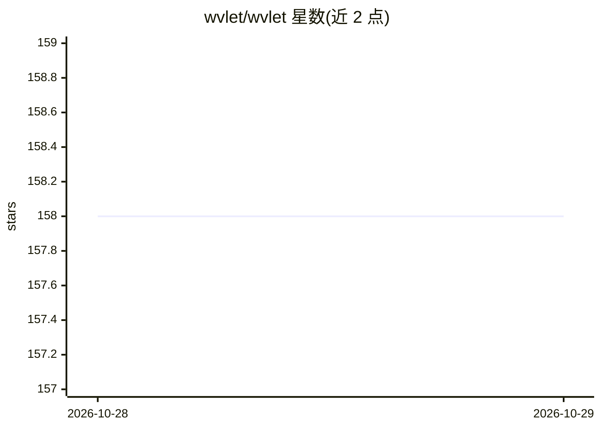

# wvlet/wvlet

⭐ 158 · Scala · Apache-2.0 · 推送 2026-10-28 · [GitHub](https://github.com/wvlet/wvlet) · [官网](https://wvlet.org/wvlet/) · 组织维护

**编译到 SQL 的流式查询语言，供数据建模与探索**

面向 SQL 引擎的新查询语言 Wvlet：以 from 起始的管道式语法按数据流的自然顺序书写查询，编译为 SQL 后在 DuckDB、Trino、Hive 等引擎上执行。提供交互式 REPL、编译期类型检查与模块化查询函数。文档以 llms.txt/llms-full.txt 纯文本形式提供，并附面向 AI agent 的语法速查、SQL 到 Wvlet 映射与常见错误说明。用 Scala 3 实现。

## 筛选速览

| 维度 | 判定 | 备注 |
|---|---|---|
| AI 角色 | `ai-enhanced` | 去掉 AI 部分产品仍成立 |
| 许可风险 | `permissive` | Apache-2.0 |
| 部署形态 | `None` |  |
| 模型依赖 | — | README 未给出锁定关系 |
| 硬件要求 | — | 无带数字的原话,不猜 |
| 安装摩擦 | `low` | 无编译、无系统依赖或容器化 |
| 成熟度 | — | 结构信号不足 |

## 能力要点

- 管道式流式语法，按数据流自然顺序书写查询
- 编译到 SQL，支持 DuckDB、Trino、Hive 等多种引擎
- 编译期 schema 校验与交互式 REPL
- llms.txt 纯文本文档与 AI agent 专用语法资料

## 适用场景

- 在 DuckDB/Trino/Hive 上用更自然的语法做交互式数据探索
- 以函数形式组织可复用的数据建模查询
- 让 AI agent 阅读 llms.txt 文档代写 Wvlet 查询

## 场景标签

 · 领域:数据工程/查询语言

## 证据(README 行号)

> L5: Wvlet, pronounced as weave-let, is a new cross-SQL flow-style query language for functional data modeling and intera
> L12: AI coding agents: the docs are available as plain text at llms.txt (index) and llms-full.txt (all pages).

## 星数曲线

2026-10-28 158 → 2026-10-29 158（+0）

---
*卡片 v1 · prompt 1.4 · 生成 2026-10-28 · 置信度 high · 依据 README sha `861ff228d5cd` · [字段定义](../../DATASET.md)*
