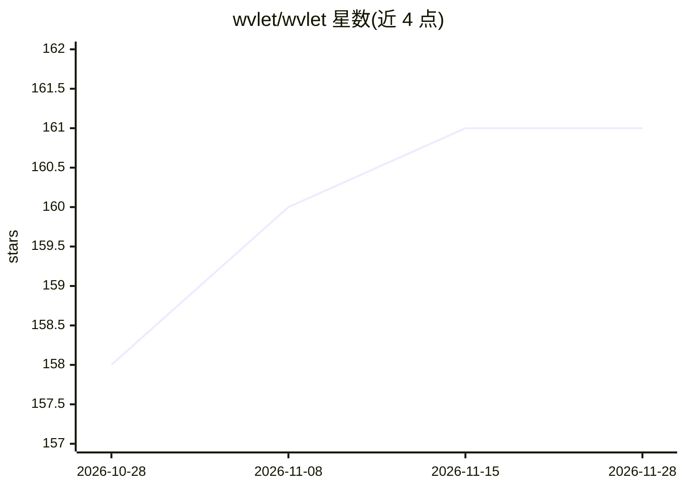

# wvlet/wvlet

⭐ 161 · Scala · Apache-2.0 · 推送 2026-11-27 · [GitHub](https://github.com/wvlet/wvlet) · [官网](https://wvlet.org/wvlet/) · 组织维护

**编译为 SQL 的流式查询语言，服务数据分析与 AI 编码代理**

Wvlet 是一种跨 SQL 引擎的 flow-style 查询语言，查询以 .wv 文件保存，编译为 SQL 查询序列，支持 DuckDB、Trino、Hive 等数据库引擎。语言从 `from` 表扫描开始按数据处理顺序串联 where/group by/select 等算子，支持编译期类型检查与查询模块化复用，并提供带自动补全的交互式 REPL。面向数据建模与交互式数据探索的开发者；为 AI 编码代理提供 Agent Skill（含语法速查、SQL 映射、常见错误），CI 对其中示例逐一编译验证，文档以 llms.txt 纯文本形式分发。

## 筛选速览

| 维度 | 判定 | 备注 |
|---|---|---|
| AI 角色 | `ai-enhanced` | 去掉 AI 部分产品仍成立 |
| 许可风险 | `permissive` | Apache-2.0 |
| 部署形态 | `None` |  |
| 模型依赖 | — | README 未给出锁定关系 |
| 硬件要求 | — | 无带数字的原话,不猜 |
| 安装摩擦 | `low` | 无编译、无系统依赖或容器化 |
| 成熟度 | — | 结构信号不足 |

## 能力要点

- flow-style 语法按数据处理顺序书写查询并编译为 SQL
- 多数据库支持：DuckDB、Trino、Hive 等
- 编译期 schema 校验捕获类型错误，交互式 REPL 自动补全
- 提供面向 AI 编码代理的 Agent Skill 与 llms.txt 文档

## 适用场景

- 为 DuckDB/Trino/Hive 编写可复用、可模块化的分析查询
- 以管道式语法描述数据处理流水线
- 让 AI 编码代理学习并生成 Wvlet 查询

## 场景标签

`数据分析` `代码生成` · 领域:效率与自动化

## 证据(README 行号)

> L5: Wvlet, pronounced as weave-let, is a new cross-SQL flow-style query language for functional data modeling and intera
> L38: - **Multi-database support**: Works with DuckDB, Trino, Hive, and more
> L43: ## For AI Agents

## 星数曲线

2026-10-28 158 → 2026-11-28 161（+3）

---
*卡片 v1 · prompt 1.4 · 生成 2026-11-27 · 置信度 high · 依据 README sha `a47089ced630` · [字段定义](../../DATASET.md)*
