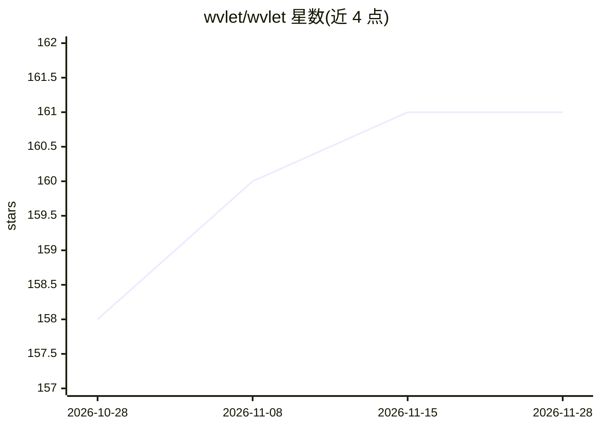

# wvlet/wvlet

⭐ 161 · Scala · Apache-2.0 · 推送 2026-11-27 · [GitHub](https://github.com/wvlet/wvlet) · [官网](https://wvlet.org/wvlet/) · 组织维护

**供数据工程用的流式查询语言，可编译为多种 SQL**

Wvlet 是一种 flow-style 查询语言：查询从表出发，按数据流顺序串联 where/group by/select 等算子，可在 JVM、原生二进制、Node.js 或浏览器中由内置引擎进程内运行，也可将同一查询编译为 DuckDB、Trino、Snowflake、Hive 的 SQL。提供 REPL、编译期类型检查与模块化查询。面向数据处理管道的编写者与维护者；项目为 AI 编码 agent 提供 Agent Skill、语法速查表与 llms.txt 文档，供 agent 学习其语法与 CLI。

## 筛选速览

| 维度 | 判定 | 备注 |
|---|---|---|
| AI 角色 | `ai-enhanced` | 去掉 AI 部分产品仍成立 |
| 许可风险 | `permissive` | Apache-2.0 |
| 部署形态 | `None` |  |
| 模型依赖 | — | README 未给出锁定关系 |
| 硬件要求 | — | 无带数字的原话,不猜 |
| 安装摩擦 | `low` | 无编译、无系统依赖或容器化 |
| 成熟度 | — | 结构信号不足 |

## 能力要点

- 同一查询可编译为 DuckDB/Trino/Snowflake/Hive 四种 SQL
- 内置列式查询引擎，运行 22 条 TPC-H 与 99 条 TPC-DS 查询
- 编译期 schema 校验的类型安全查询与可模块化复用的查询
- 面向 AI agent 的 Agent Skill 与 llms.txt 纯文本文档，CI 编译全部示例

## 适用场景

- 以管道风格编写和维护复杂的数据处理查询
- 跨 DuckDB/Trino/Snowflake/Hive 复用同一套查询
- 让 AI 编码 agent 学习并生成 wvlet 语法查询

## 场景标签

`数据分析` · 领域:效率与自动化

## 证据(README 行号)

> L5: Wvlet, pronounced as weave-let, is a flow-style query language with a columnar query engine built in. Queries start 
> L45: - **Built-in engine**: Runs all 22 TPC-H and 99 TPC-DS queries, with steady-state speed on par with DuckDB at scale

## 星数曲线

2026-10-28 158 → 2026-11-28 161（+3）

---
*卡片 v1 · prompt 1.4 · 生成 2026-11-28 · 置信度 high · 依据 README sha `4e8fafb01c0b` · [字段定义](../../DATASET.md)*
