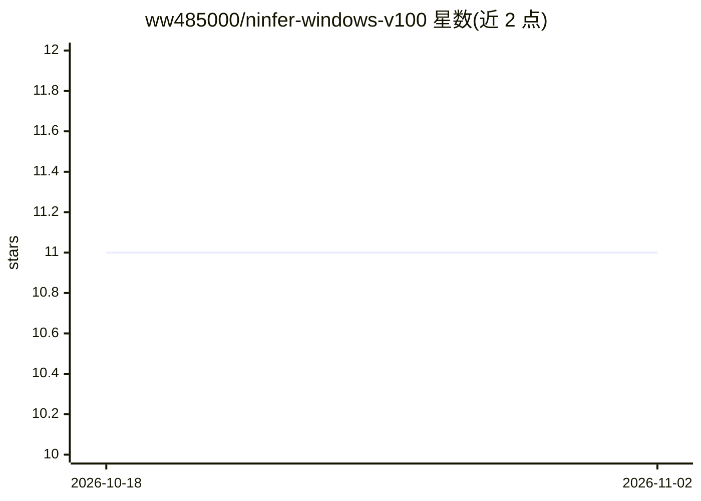

# ww485000/ninfer-windows-v100

⭐ 11 · C++ · Apache-2.0 · 推送 2026-09-26 · [GitHub](https://github.com/ww485000/ninfer-windows-v100) · 个人维护 · 中文 README

**面向单卡 Tesla V100 32GB 的 Windows 推理运行时移植**

NInfer 的 Windows 专用移植，目标平台锁定为一块 NVIDIA Tesla V100 32GB（sm_70）：提供 MSVC/vcpkg 构建、模型工件下载与校验、CLI 生成、OpenAI/Anthropic 兼容 HTTP 服务及启动脚本。推荐配置为 Qwen3.8-27B NVFP4（官方与 uncensored 两个工件），通过 Volta 特定的软件解码与 FP16 tensor-core/SIMT 内核执行 NVFP4。限制：不支持 Linux/WSL/Docker、多 GPU、分布式服务与任意 GGUF/Safetensors 文件；构建脚本拒绝非 Volta GPU。面向持有 V100 的 Windows 开发者。

## 筛选速览

| 维度 | 判定 | 备注 |
|---|---|---|
| AI 角色 | `ai-ecosystem` | LLM/agent 周边工具 |
| 许可风险 | `permissive` | Apache-2.0 |
| 部署形态 | `desktop` | 安装包/桌面程序 |
| 模型依赖 | — | README 未给出锁定关系 |
| 硬件要求 | — | 无带数字的原话,不猜 |
| 安装摩擦 | `high` | 编译与系统依赖俱全 |
| 成熟度 | — | 结构信号不足 |

## 能力要点

- Qwen3.8-27B NVFP4 实测 pp2048+tg256 228.14 tok/s，MTP 接受率 99.17%
- 提供 CLI 生成与 OpenAI/Anthropic 兼容 API 服务（端口 7105）
- 带 SHA-256 校验的模型下载脚本与双击启动/停止批处理
- INT8 group-64 KV、CUDA Graphs、MTP K=3、240,000 token 逻辑上下文

## 适用场景

- 在 Windows 上用单块 V100 32GB 运行 Qwen3.8-27B NVFP4
- 通过 OpenAI 兼容接口本地提供聊天补全服务
- 复现仓库给出的 V100 基准测试结果

## 场景标签

 · 领域:LLM 推理基础设施

## 证据(README 行号)

> L5: Native Windows port of NInfer for **one NVIDIA Tesla V100 32GB (`sm_70`)**. This repository is
> L103: .\serve-qwen38-v100.ps1 -Variant official -Port 7105
> L144: - Text and optional image/video input through CLI, OpenAI-compatible, and Anthropic-compatible APIs.

## 星数曲线

2026-10-18 11 → 2026-11-02 11（+0）

---
*卡片 v1 · prompt 1.4 · 生成 2026-11-02 · 置信度 high · 依据 README sha `8346e850d1d3` · [字段定义](../../DATASET.md)*
