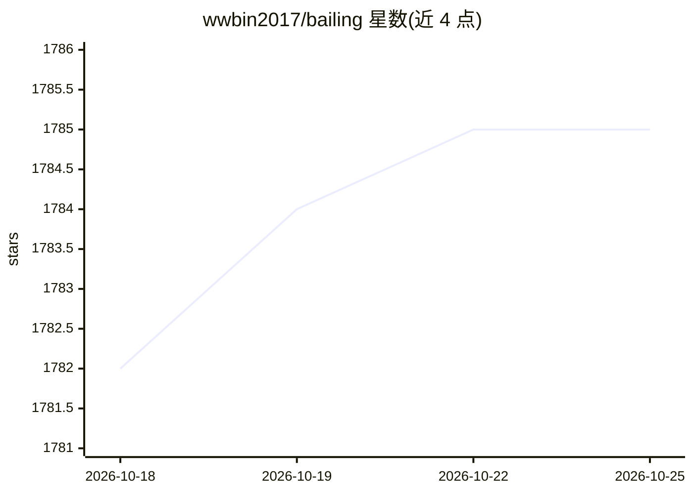

# wwbin2017/bailing

⭐ 1,785 · Python · MIT · 推送 2026-04-06 · [GitHub](https://github.com/wwbin2017/bailing) · 个人维护 · 中文 README

**开源语音对话助手：ASR+LLM+TTS 实现低时延语音交互**

百聆是开源语音对话机器人，用 FunASR 做语音识别、silero-vad 做语音活动检测、DeepSeek 等大模型生成回复，再经 edge-tts/Kokoro-82M/ChatTTS/macOS say 合成语音，端到端时延 800ms，支持打断、记忆、任务管理与工具调用；通过 OpenClaw 接入外部工具处理多步骤任务。模块化设计可替换各组件，无需 GPU 即可本地运行，也支持服务器部署并经移动端对话。声明仅用于个人学习研究。

## 筛选速览

| 维度 | 判定 | 备注 |
|---|---|---|
| AI 角色 | `ai-native` | 本体是模型或模型工具 |
| 许可风险 | `permissive` | MIT |
| 部署形态 | `library` | 以包/库形式分发 |
| 模型依赖 | locked-api |  |
| 硬件要求 | `cpu-ok` | |
| 安装摩擦 | `low` | 无编译、无系统依赖或容器化 |
| 成熟度 | — | 结构信号不足 |

## 能力要点

- ASR+VAD+LLM+TTS 流水线，模块化可替换各组件
- 支持语音打断、记忆与任务管理
- 通过 OpenClaw 统一接入外部工具与多步骤任务执行
- 无需 GPU 可运行，端到端时延 800ms

## 适用场景

- 在 Mac 等低配置设备上本地跑一个语音对话助手
- 用语音让助手查天气、设提醒、搜索、打开应用
- 通过 OpenClaw 执行更复杂的多步骤任务

## 场景标签

`语音 Agent` `AI 助手` · 领域:对话与助手

## 证据(README 行号)

> L5: **百聆** 是一个开源的语音对话助手，旨在通过语音与用户进行自然的对话。该项目结合了语音识别 (ASR)、语音活动检测 (VAD)、大语言模型 (LLM) 和语音合成 (TTS) 技术，这是一个类似GPT-4o的语音对话机器人，通
> L45: - 🎙 **ASR**: 使用 FunASR 进行自动语音识别，将用户的语音转换为文本。
> L47: - 🧠 **LLM**: 使用 deepseek 作为大语言模型来处理用户输入并生成响应，极具性价比。

## 星数曲线

2026-10-18 1,782 → 2026-10-25 1,785（+3）

---
*卡片 v1 · prompt 1.4 · 生成 2026-10-21 · 置信度 mid · 依据 README sha `2baeebfd15bf` · [字段定义](../../DATASET.md)*
