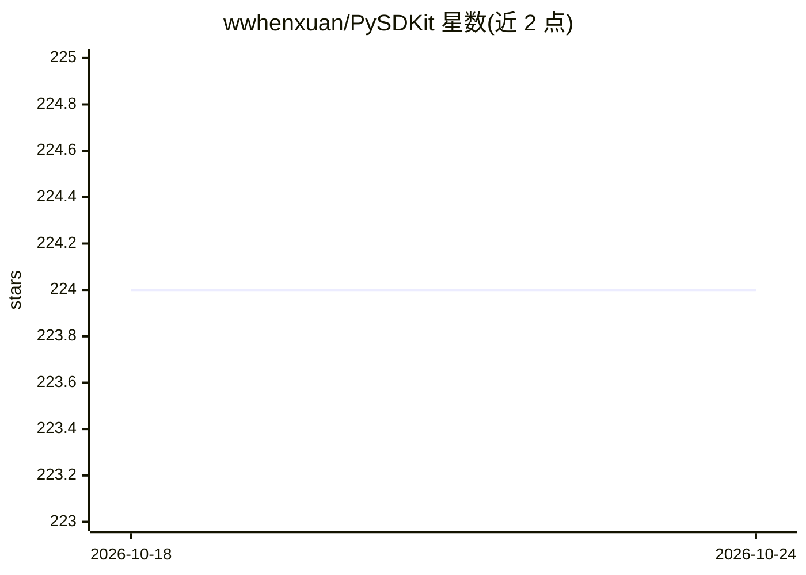

# wwhenxuan/PySDKit

⭐ 224 · Python · MIT · 推送 2026-08-31 · [GitHub](https://github.com/wwhenxuan/PySDKit) · [官网](https://pysdkit.readthedocs.io/en/stable/index.html) · 个人维护

**面向信号分解算法的 Python 库：一维/多维信号与图像分解**

Python 信号分解算法库，收录 EMD、VMD、MVMD、SSA、EWT 等 30 余种算法，覆盖一元信号、多元信号与二维图像分解，并提供内置可视化接口。API 采用类似 Scikit-learn 的通用流程：导入算法、创建实例、调用 fit_transform 完成分解，再对原始信号与所得 IMF 进行可视化分析。依赖仅 NumPy、SciPy 和 matplotlib，通过 pip 安装。README 声明项目仍在开发中，正在持续复现表中列出的算法。

## 筛选速览

| 维度 | 判定 | 备注 |
|---|---|---|
| AI 角色 | `ai-native` | 本体是模型或模型工具 |
| 许可风险 | `permissive` | MIT |
| 部署形态 | `library` | 以包/库形式分发 |
| 模型依赖 | — | README 未给出锁定关系 |
| 硬件要求 | — | 无带数字的原话,不猜 |
| 安装摩擦 | `low` | 无编译、无系统依赖或容器化 |
| 成熟度 | `idea` | |

## 能力要点

- 收录 30 余种信号分解算法（EMD/VMD/MVMD/SSA/EWT 等），含图像二维分解
- 类 Scikit-learn 接口：fit_transform 完成分解
- 内置 IMF 可视化（含二维时频视图）
- 依赖仅 NumPy/SciPy/matplotlib

## 适用场景

- 对时序信号做模态分解并提取固有模态函数 IMF
- 多通道记录信号中保持跨通道模态对齐的分解（MVMD）
- 二维图像的分解分析（EMD2D/VMD2D/BMEMD）

## 场景标签

 · 领域:信号处理/时序分析

## 证据(README 行号)

> L10: A Python library for signal decomposition algorithms 🥳
> L31: This project integrates simple signal processing methods, signal decomposition and visualization, and builds a gene

## 星数曲线

2026-10-18 224 → 2026-10-24 224（+0）

---
*卡片 v1 · prompt 1.4 · 生成 2026-10-22 · 置信度 mid · 依据 README sha `c8395cfd67cf` · [字段定义](../../DATASET.md)*
