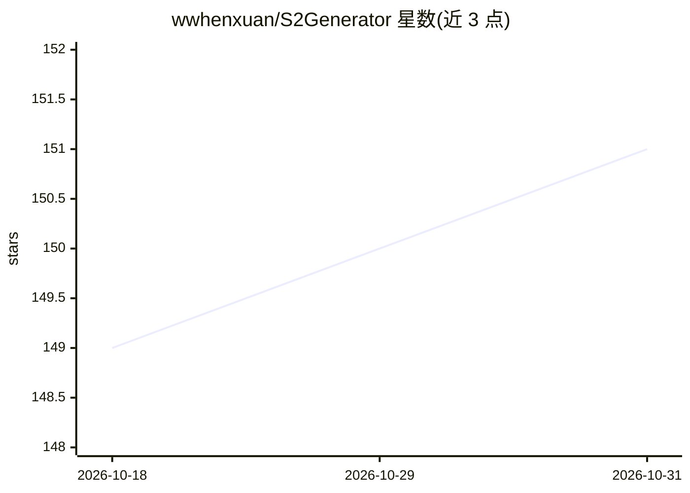

# wwhenxuan/S2Generator

⭐ 151 · Python · MIT · 推送 2026-09-17 · [GitHub](https://github.com/wwhenxuan/S2Generator) · 组织维护

**生成符号表达式配对时间序列的双模态合成数据工具**

基于时间序列是复杂动力学系统外部表现的观点，提供序列-符号双模态数据生成机制：以二叉树构建符号表达式表示的复杂系统 f(·)，结合 MixedDistribution、ARMA、ForecastPFN、KernelSynth、IntrinsicModeFunction 五种方法生成激励序列 X，输出响应序列 Y=f(X)。支持自定义表达式绑定（CustomSymbolGenerator）、多变量与可调序列长度，另含 IQ 信道模拟器与基于 SCM 的复现模块。以 Python 库形式发布于 PyPI，面向时间序列基础模型预训练数据的构建。

## 筛选速览

| 维度 | 判定 | 备注 |
|---|---|---|
| AI 角色 | `ai-ecosystem` | LLM/agent 周边工具 |
| 许可风险 | `permissive` | MIT |
| 部署形态 | `library` | 以包/库形式分发 |
| 模型依赖 | — | README 未给出锁定关系 |
| 硬件要求 | — | 无带数字的原话,不猜 |
| 安装摩擦 | `low` | 无编译、无系统依赖或容器化 |
| 成熟度 | — | 结构信号不足 |

## 能力要点

- 二叉树构建多样化符号表达式形式的复杂系统
- 5 种激励时间序列生成方法（混合分布/ARMA/ForecastPFN/KernelSynth/IMF）
- CustomSymbolGenerator 支持绑定用户指定表达式生成数据
- 支持多输入/输出维度与可调序列长度，含 IQ 信道与 SCM 生成模块

## 适用场景

- 为时间序列基础模型预训练构建合成数据集
- 生成带符号表达式的可解释双模态时序数据
- 复现基于结构因果模型的多变量时序生成算法

## 场景标签

 · 领域:时间序列/合成数据生成

## 证据(README 行号)

> L6: we propose a bimodal generative mechanism for time series data that integrates both symbolic and series modalities.
> L9: This method allows for the unrestricted creation of high-quality time series data for pre-training the time series f

## 星数曲线

2026-10-18 149 → 2026-10-31 151（+2）

---
*卡片 v1 · prompt 1.4 · 生成 2026-10-22 · 置信度 high · 依据 README sha `cfd0cbd836d7` · [字段定义](../../DATASET.md)*
