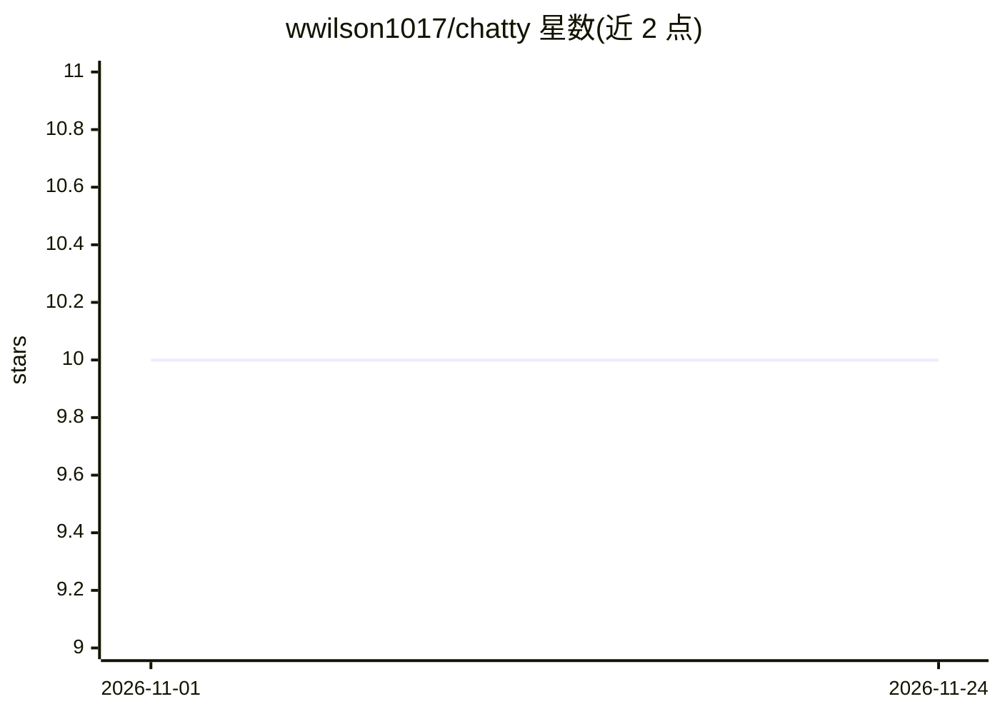

# wwilson1017/chatty

⭐ 10 · Python · MIT · 推送 2026-10-31 · [GitHub](https://github.com/wwilson1017/chatty) · 个人维护

**面向个人与中小企业的开源浏览器端 AI 助手平台**

浏览器运行的 Web 端 AI agent 平台，数据存于本地 SQLite，支持本地运行或部署到 Railway。内置多 agent 管理、定时后台任务（Heartbeat）、提醒、GTD 待办系统、记忆与向量检索、会议录音转录、费用统计看板；集成 Gmail、Google Calendar/Drive、QuickBooks Online、Odoo、BambooHR、Telegram 等服务，并含 CRM Lite。AI 部分接 Anthropic、OpenAI、Gemini、Together AI 或本地 Ollama，工具调用依赖支持 tool calling 的模型。安装需 Python 3.10+ 与 Node.js 18+。

## 筛选速览

| 维度 | 判定 | 备注 |
|---|---|---|
| AI 角色 | `ai-native` | 本体是模型或模型工具 |
| 许可风险 | `permissive` | MIT |
| 部署形态 | `None` |  |
| 模型依赖 | local-ok | 支持本地模型 |
| 硬件要求 | — | 无带数字的原话,不猜 |
| 安装摩擦 | `low` | 无编译、无系统依赖或容器化 |
| 成熟度 | — | 结构信号不足 |

## 能力要点

- 多 agent 管理，支持 Anthropic/OpenAI/Gemini/Ollama/Together 多提供商
- Heartbeat 定时后台任务，经浏览器推送/Telegram/WhatsApp 通知
- 内置完整 GTD 待办系统与语义向量记忆
- Gmail/QuickBooks/Odoo/BambooHR 等集成与会议转录

## 适用场景

- 个人或小企业用 AI 助手管理邮件、日历与待办
- 在本地或自有服务器上运行不依赖第三方云的 AI 助手
- 通过 Telegram 或手机快捷页面随时录入待办
- 用本地 Ollama 模型零 API 费用运行 agent

## 场景标签

`AI 助手` · 领域:对话与助手

## 证据(README 行号)

> L5: A free, open-source personal AI assistant for business or personal use — a simple, easy, web-based agent platform, n
> L19: - **Multi-provider AI** — Anthropic, OpenAI, Google Gemini, Ollama (local models), and Together AI

## 星数曲线

2026-11-01 10 → 2026-11-24 10（+0）

---
*卡片 v1 · prompt 1.4 · 生成 2026-11-19 · 置信度 high · 依据 README sha `f6e44decee8a` · [字段定义](../../DATASET.md)*
