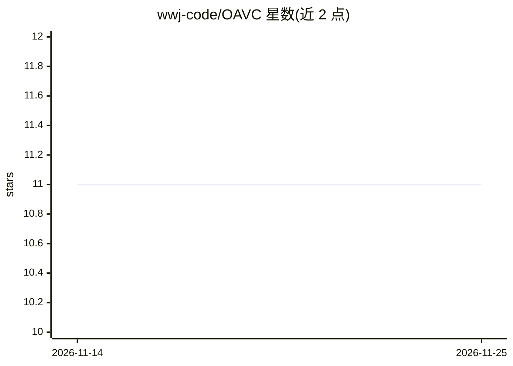

# wwj-code/OAVC

⭐ 11 · Python · MIT · 推送 2026-11-14 · [GitHub](https://github.com/wwj-code/OAVC) · [官网](https://arxiv.org/abs/2609.06288) · 组织维护 · 中文 README

**免训练的图像/视频编辑方法：只改目标物体，背景保持不变**

OAVC 是论文的官方实现，一种无需训练的文本引导图像与视频编辑方法，基于整流流模型（Stable Diffusion 3.5、FLUX.1-dev、Wan2.1）。通过两阶段机制：先在源提示词下构建背景锚定参考，再仅将目标提示词的速度变化注入 SAM3 给出的物体支持区域，配合边界环、置信门控等控制手段。提供 PIE-Bench 图像编辑与 DAVIS 视频编辑脚本、指标评估脚本，以及支持画笔标注的 Gradio 交互式 demo。

## 筛选速览

| 维度 | 判定 | 备注 |
|---|---|---|
| AI 角色 | `ai-native` | 本体是模型或模型工具 |
| 许可风险 | `permissive` | MIT |
| 部署形态 | `library` | 以包/库形式分发 |
| 模型依赖 | — | README 未给出锁定关系 |
| 硬件要求 | — | 无带数字的原话,不猜 |
| 安装摩擦 | `low` | 无编译、无系统依赖或容器化 |
| 成熟度 | — | 结构信号不足 |

## 能力要点

- 免训练，支持 SD3.5、FLUX.1-dev、Wan2.1 三种整流流模型
- 速度注入仅作用于 SAM3 物体支持区域，含边界环与置信门控
- Gradio 交互式 demo：画笔标注物体区域，可与 SAM3 结果合并
- 内置 PIE-Bench 与 DAVIS 评估脚本，计算背景 PSNR/LPIPS/SSIM 等指标

## 适用场景

- 对图像中指定物体做文本引导替换并保持背景稳定
- 对 DAVIS 视频序列进行物体级编辑
- 用画笔交互式修正自动物体分割后运行编辑

## 场景标签

`图像生成` · 领域:内容生成

## 证据(README 行号)

> L6: Official implementation of **Object-Aware Velocity Control (OAVC)**, a training-free method for text-guided image an
> L109: A Gradio app for editing your own images. Upload an image, paint the object to edit with the brush, enter the sour

## 星数曲线

2026-11-14 11 → 2026-11-25 11（+0）

---
*卡片 v1 · prompt 1.4 · 生成 2026-11-18 · 置信度 high · 依据 README sha `e7614e82912d` · [字段定义](../../DATASET.md)*
