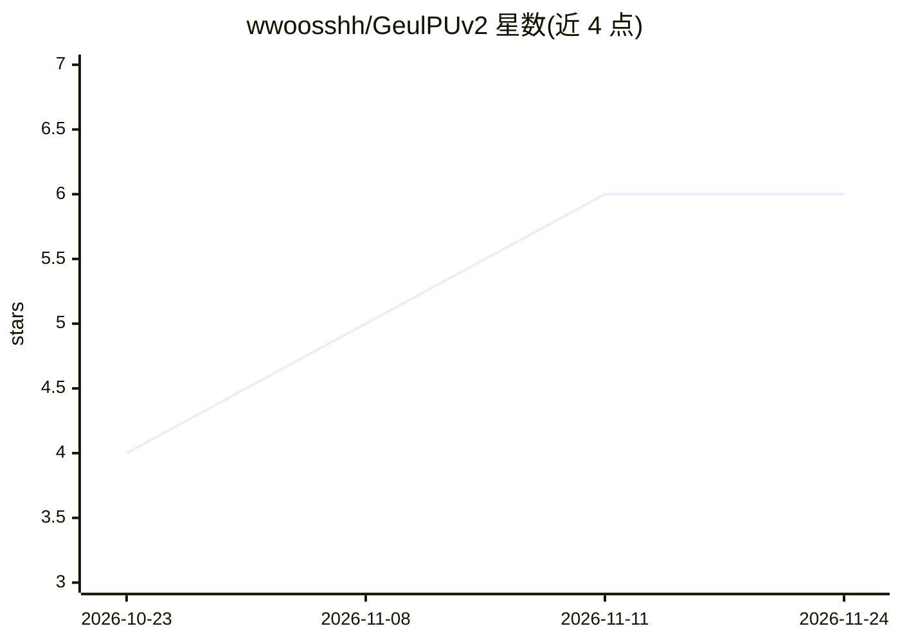

# wwoosshh/GeulPUv2

⭐ 6 · Python · MIT · 推送 2026-11-23 · [GitHub](https://github.com/wwoosshh/GeulPUv2) · 个人维护

**在自有 GPU 上运行 GGUF 模型的本地 LLM 引擎，带确定性调试器**

本地 LLM 推理引擎与调试器：在自有 NVIDIA/AMD GPU 上运行 GGUF 模型，通过书面精度契约保证输出逐位一致（与 CPU 参考实现、跨 GPU 一致），支持录制运行、逐位重放、从任意 token 分支以及逐请求比较模型与量化版本。提供浏览器聊天界面与 OpenAI 兼容等三类 API，引擎与 GPU 内核以韩文关键字的编程语言 글(geul) 编写，单文件约 1.5 MB，不依赖 CUDA toolkit、Python 或 PyTorch。面向需要在本地复现与调试 LLM 运行的开发者与研究者。

## 筛选速览

| 维度 | 判定 | 备注 |
|---|---|---|
| AI 角色 | `ai-ecosystem` | LLM/agent 周边工具 |
| 许可风险 | `permissive` | MIT |
| 部署形态 | `desktop` | 安装包/桌面程序 |
| 模型依赖 | local-ok | 支持本地模型 |
| 硬件要求 | — | 无带数字的原话,不猜 |
| 安装摩擦 | `medium` | 含编译或系统依赖之一 |
| 成熟度 | — | 结构信号不足 |

## 能力要点

- 精度契约保证逐位一致的输出（批处理、prompt cache、投机解码均不改变结果）
- 调试器支持录制、逐位重放、任意 token 分支与两次运行逐请求比较
- 内置 GGUF 模型评估流程（GSM8K、MMLU-Pro，对比微调前后）
- 提供 OpenAI/Anthropic Messages/OpenAI Responses 兼容 API 与 lm-evaluation-harness 支持

## 适用场景

- 在本地 GPU 上运行 GGUF 模型并获得可复现的输出
- 录制 agent 会话后重放，定位单次修改带来的影响
- 逐请求比较不同量化版本或模型的行为差异
- 将运行记录导出为文件，在另一台机器上逐位核验复现

## 场景标签

`推理引擎` · 领域:训练与推理

## 证据(README 行号)

> L7: A local LLM engine with a debugger: record a run, replay it bit for bit,
> L25: screen in the browser and an OpenAI-compatible API. Its arithmetic is fixed by a written **precision contract**, so
> L57: - **Works with your tools.** OpenAI-compatible, Anthropic Messages and OpenAI Responses APIs with tool calling for 

## 星数曲线

2026-10-23 4 → 2026-11-24 6（+2）

---
*卡片 v1 · prompt 1.4 · 生成 2026-11-20 · 置信度 high · 依据 README sha `0dab2c8b0f7a` · [字段定义](../../DATASET.md)*
