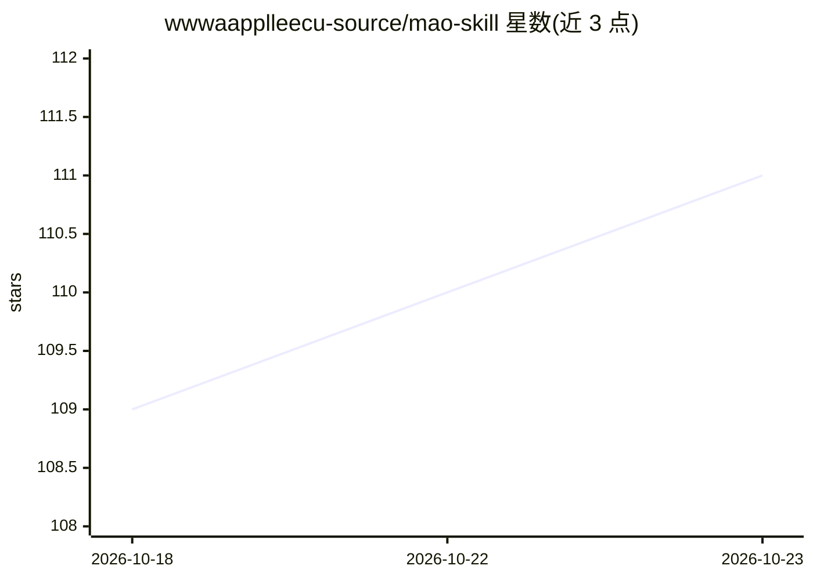

# wwwaapplleecu-source/mao-skill

⭐ 111 · Python · MIT · 推送 2026-04-09 · [GitHub](https://github.com/wwwaapplleecu-source/mao-skill) · 个人维护 · 中文 README

**面向 Claude Code/OpenClaw 的毛泽东方法论分析技能包**

以整个仓库形式提供的 Agent Skill：安装到 OpenClaw 或 Claude Code 的技能目录后，通过 /mao 命令体系提供 6 种分析方法（矛盾分析、实践论、调查研究、战略思维、群众路线、综合分析）、四级渐进学习路径（15 分钟至 10 小时）与 674 个概念的概念查询库。方法论基于《实践论》《矛盾论》《论持久战》《毛泽东选集》等原著构建，需 Python 3.8+ 并安装 requirements.txt 依赖；其他 Agent 平台需自行适配。README 声明保持学术中立，不讨论敏感历史事件。

## 筛选速览

| 维度 | 判定 | 备注 |
|---|---|---|
| AI 角色 | `ai-knowledge` | 知识聚合/清单类 |
| 许可风险 | `permissive` | MIT |
| 部署形态 | `library` | 以包/库形式分发 |
| 模型依赖 | — | README 未给出锁定关系 |
| 硬件要求 | — | 无带数字的原话,不猜 |
| 安装摩擦 | `low` | 无编译、无系统依赖或容器化 |
| 成熟度 | — | 结构信号不足 |

## 能力要点

- 6 种分析方法自动推荐与指定调用（/mao analyze）
- 四级渐进学习路径：入门/基础/进阶/专业
- 674 个毛泽东核心概念库，支持查询与搜索
- 原生支持 OpenClaw，兼容 Claude Code

## 适用场景

- 在 Claude Code/OpenClaw 中用 /mao 命令对问题做矛盾分析或战略分析
- 按渐进路径学习毛泽东方法论体系
- 查询矛盾、群众路线等概念的解释与应用示例

## 场景标签

 · 领域:AI 技能/方法论知识工具

## 证据(README 行号)

> L27: |**中文**|毛泽东方法论AI助手 - 基于六层认知架构的智能分析系统，提供矛盾分析、实践指导、调查研究等6种核心方法，支持674个概念查询和四级渐进学习。|📦 安装 • 🚀 使用 • 📚 学习|
> L54: |**渐进学习**|四级渐进学习路径：入门(15分钟)→基础(1小时)→进阶(3小时)→专业(10小时)|`/mao learn --path=入门`|
> L55: |**概念查询**|674个毛泽东核心概念库，支持概念查询和关系探索|`/mao concepts 矛盾`|

## 星数曲线

2026-10-18 109 → 2026-10-23 111（+2）

---
*卡片 v1 · prompt 1.4 · 生成 2026-10-23 · 置信度 mid · 依据 README sha `034b94a0c5ee` · [字段定义](../../DATASET.md)*
