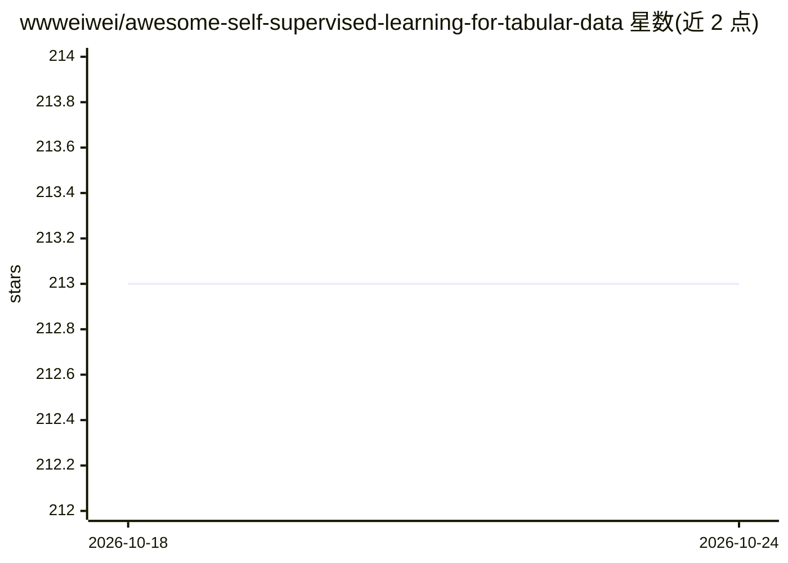

# wwweiwei/awesome-self-supervised-learning-for-tabular-data

⭐ 213 · 推送 2026-04-13 · [GitHub](https://github.com/wwweiwei/awesome-self-supervised-learning-for-tabular-data) · [官网](http://arxiv.org/abs/2402.01204) · 个人维护

**非序列表格数据自监督学习研究论文与资源清单**

由 Wei-Wei Du 与 Wei-Yao Wang 维护的研究资料合集，围绕非序列表格数据的自监督学习（SSL4NSTD）组织，配套其 ACML-24 Journal Track 综述论文。内容按 Predictive Learning、Contrastive Learning、Hybrid Learning 三类收录论文条目（含论文、代码、补充材料链接），另设 Benchmarks、Tutorials、Workshops、Related Survey 与 Tools & Libraries 栏目；条目持续更新，接受 issue 与 PR。

## 筛选速览

| 维度 | 判定 | 备注 |
|---|---|---|
| AI 角色 | `ai-knowledge` | 知识聚合/清单类 |
| 许可风险 | `none` | — |
| 部署形态 | `None` |  |
| 模型依赖 | — | README 未给出锁定关系 |
| 硬件要求 | — | 无带数字的原话,不猜 |
| 安装摩擦 | `low` | 无编译、无系统依赖或容器化 |
| 成熟度 | — | 结构信号不足 |

## 能力要点

- 按三类学习方法组织的论文清单，条目附论文/代码/补充材料链接
- 配套 ACML-24 综述论文并给出引用信息
- 收录 6 个表格学习基准、相关教程与研讨会链接
- Tools & Libraries 收录 PyTorch Frame、PyTorch Tabular 等框架

## 适用场景

- 查找表格数据自监督学习的论文与开源代码
- 跟踪表格基础模型方向的会议论文进展
- 选择表格学习研究的基准数据集与工具框架

## 场景标签

`精选清单` · 领域:学习与行业

## 证据(README 行号)

> L1: # Awesome Self-Supervised Learning for Non-Sequential Tabular Data (SSL4NSTD)
> L6: This repository contains the frontier research on **self-supervised learning** for tabular data which has been a pop

## 星数曲线

2026-10-18 213 → 2026-10-24 213（+0）

---
*卡片 v1 · prompt 1.4 · 生成 2026-10-22 · 置信度 high · 依据 README sha `afc241b1d110` · [字段定义](../../DATASET.md)*
