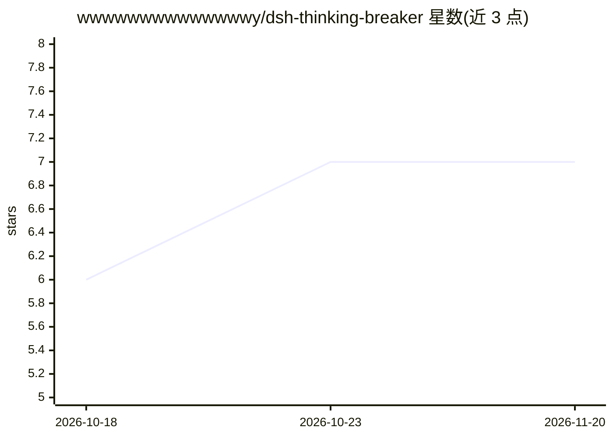

# wwwwwwwwwwwwwwy/dsh-thinking-breaker

⭐ — · [GitHub]() · 个人维护

**为 dsh agent 会话提供推理循环与工具故障熔断的宿主插件**

DeepSeek Harness（dsh）的宿主插件，提供三类熔断：思考流连续重复 ≥10 块时中止请求并以关闭思考方式重试一次；无意义输出（星号洪水、emoji 洪水、标点汤）两块内即中止；同一工具调用反复失败时先提示改换思路、超阈值后在派发前拒绝。检测基于不相交分块指纹与 Jaccard 新鲜度，阈值经 6 种循环形态×3 干净语料校准。通过 llm/stream、agent/request、tools/* 钩子实现，需重启宿主生效；上下文不回滚、无跨步骤轮次预算。

## 筛选速览

| 维度 | 判定 | 备注 |
|---|---|---|
| AI 角色 | `ai-ecosystem` | LLM/agent 周边工具 |
| 许可风险 | `permissive` | — |
| 部署形态 | `None` |  |
| 模型依赖 | — | README 未给出锁定关系 |
| 硬件要求 | — | 无带数字的原话,不猜 |
| 安装摩擦 | `low` | 无编译、无系统依赖或容器化 |
| 成熟度 | — | 结构信号不足 |

## 能力要点

- 推理重复与输出退化双检测器：分块指纹 + 4-gram Jaccard + 多信号投票
- 工具故障先引导后派发前拒绝，签名按工具+归一化参数匹配
- 阈值经 calibrate.mjs 在 6 种循环形态与干净语料上实测校准
- 中止原因为 aborted，插件显式选择每轮重试一次

## 适用场景

- dsh agent 会话中模型思考陷入重复循环时自动中止并重试
- 拦截星号/emoji 洪水等无意义思考流输出
- 同一工具调用反复失败时阻止再次执行

## 场景标签

 · 领域:LLM 基础设施/agent 可靠性

## 证据(README 行号)

> L3: **Three circuit breakers for DeepSeek Harness (dsh) agent sessions — in one host plugin.**
> L21: A skill or prompt is a document the model has to choose to read. A model already stuck in a loop will not read it, 

## 星数曲线

2026-10-18 6 → 2026-11-20 7（+1）

---
*卡片 v1 · prompt 1.4 · 生成 2026-11-20 · 置信度 high · 依据 README sha `663f09c6c541` · [字段定义](../../DATASET.md)*
