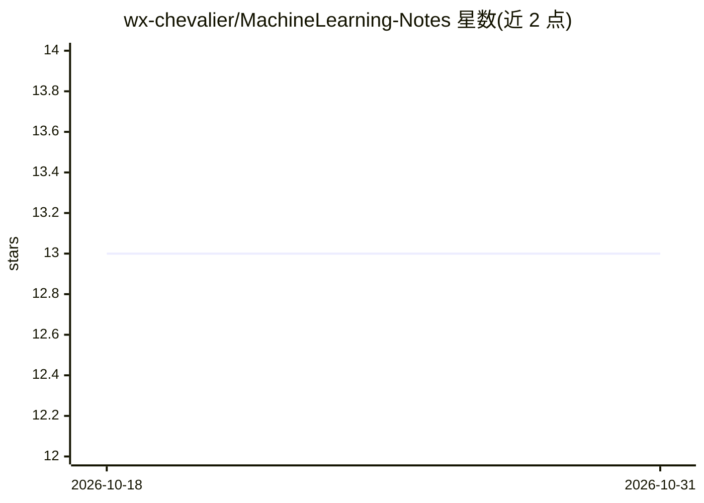

# wx-chevalier/MachineLearning-Notes

⭐ 13 · Jupyter Notebook · NOASSERTION · 推送 2026-09-27 · [GitHub](https://github.com/wx-chevalier/MachineLearning-Notes) · [官网](https://ng-tech.icu/books/MachineLearning-Series) · 个人维护 · 中文 README

**机器学习知识笔记：概念、任务分类与算法导览**

个人维护的机器学习学习笔记仓库，属于系列书籍（AI-Notes/NGTE Books）的机器学习篇。内容以中文文章形式介绍数据挖掘与机器学习的概念、预测性与描述性任务的区分、常见算法分类（分类、聚类、关联规则挖掘、时间序列、回归）及工作流程，提供在线阅读入口，并附参考链接与系列书籍导航。不提供可直接运行的软件或代码库安装，采用 CC BY-NC-SA 4.0 许可（署名-非商业-禁止演绎）。

## 筛选速览

| 维度 | 判定 | 备注 |
|---|---|---|
| AI 角色 | `ai-knowledge` | 知识聚合/清单类 |
| 许可风险 | `none` | NOASSERTION |
| 部署形态 | `None` |  |
| 模型依赖 | — | README 未给出锁定关系 |
| 硬件要求 | — | 无带数字的原话,不猜 |
| 安装摩擦 | `low` | 无编译、无系统依赖或容器化 |
| 成熟度 | — | 结构信号不足 |

## 能力要点

- 中文体系化的机器学习概念与任务分类笔记
- 提供在线阅读入口与系列知识体系导航
- CC BY-NC-SA 4.0 许可下的系列书籍之一

## 适用场景

- 系统学习机器学习基础概念与算法分类
- 作为数据挖掘与机器学习任务的入门导览资料

## 场景标签

`教程课程` · 领域:学习与行业

## 证据(README 行号)

> L19: 互联网的迅猛发展催生了数据的爆炸式增长。面对海量数据，如何挖掘数据的架子，成为一个越来越重要的问题。首先，对于数据挖掘的概念，目前比较广泛认可的一种解释如下：数据挖掘是一种通过分析海量数据，从数据中提取潜在的但是非常有用的模式的技
> L23: 机器学习即是指能够帮你从数据中寻找到感兴趣的部分而不需要编写特定的问题解决方案的通用算法的集合。通用的算法可以根据你不同的输入数据来自动地构建面向数据集合最优的处理逻辑。举例而言，算法中一个大的分类即分类算法，它可以将数据分类到不
> L56: 笔者所有文章遵循知识共享 署名 - 非商业性使用 - 禁止演绎 4.0 国际许可协议，欢迎转载，尊重版权。您还可以前往 NGTE Books 主页浏览包含知识体系、编程语言、软件工程、模式与架构、Web 与大前端、服务端开发实践与

## 星数曲线

2026-10-18 13 → 2026-10-31 13（+0）

---
*卡片 v1 · prompt 1.4 · 生成 2026-10-31 · 置信度 high · 依据 README sha `41777fb3c7f8` · [字段定义](../../DATASET.md)*
