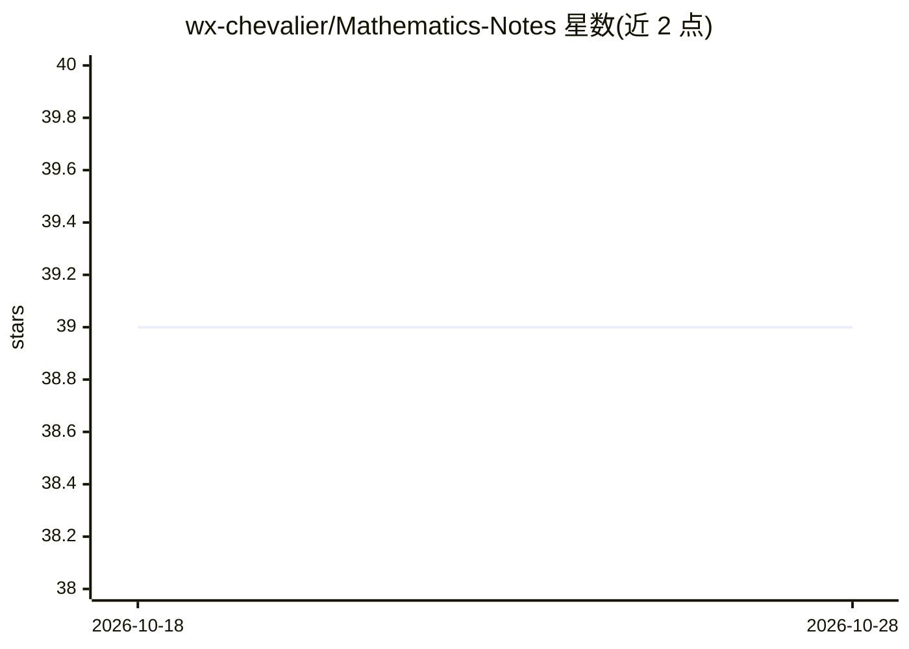

# wx-chevalier/Mathematics-Notes

⭐ 39 · Jupyter Notebook · NOASSERTION · 推送 2026-09-27 · [GitHub](https://github.com/wx-chevalier/Mathematics-Notes) · [官网](https://ng-tech.icu/books/Mathematics-Series) · 个人维护 · 中文 README

**面向 AI/ML 学习者的应用数学知识体系笔记（md/ipynb）**

以 Markdown 与 Jupyter Notebook 形式组织的现代数学与应用数学知识体系笔记，覆盖数学基础（逻辑/集合/离散）、线性代数、微积分与分析、概率论与统计、最优化理论、数值计算方法六大部分，条目下细分到具体主题（如 SVD、Bayes 公式、Adam 算法、有限元法等）。提供在线阅读入口，属于 wx-chevalier/NGTE 系列的知识整理仓库，内容采用 CC BY-NC-SA 4.0 许可。

## 筛选速览

| 维度 | 判定 | 备注 |
|---|---|---|
| AI 角色 | `ai-knowledge` | 知识聚合/清单类 |
| 许可风险 | `none` | NOASSERTION |
| 部署形态 | `None` |  |
| 模型依赖 | — | README 未给出锁定关系 |
| 硬件要求 | — | 无带数字的原话,不猜 |
| 安装摩擦 | `low` | 无编译、无系统依赖或容器化 |
| 成熟度 | — | 结构信号不足 |

## 能力要点

- 六大知识体系：数学基础/线性代数/微积分/概率统计/最优化/数值计算
- 以 .md 与 .ipynb 两种格式组织
- 提供在线阅读入口与关联导航
- 归属 NGTE Books 系列，CC BY-NC-SA 4.0 许可

## 适用场景

- 系统梳理机器学习所需的数学知识脉络
- 按主题查找特定数学概念在知识体系中的位置
- 配合 AI/深度学习学习路线补充数理基础

## 场景标签

`教程课程` · 领域:学习与行业

## 证据(README 行号)

> L17: # 现代数学体系
> L28: # 应用数学知识体系
> L30: ## 第一部分：数学基础

## 星数曲线

2026-10-18 39 → 2026-10-28 39（+0）

---
*卡片 v1 · prompt 1.4 · 生成 2026-10-25 · 置信度 high · 依据 README sha `48dfed94916a` · [字段定义](../../DATASET.md)*
