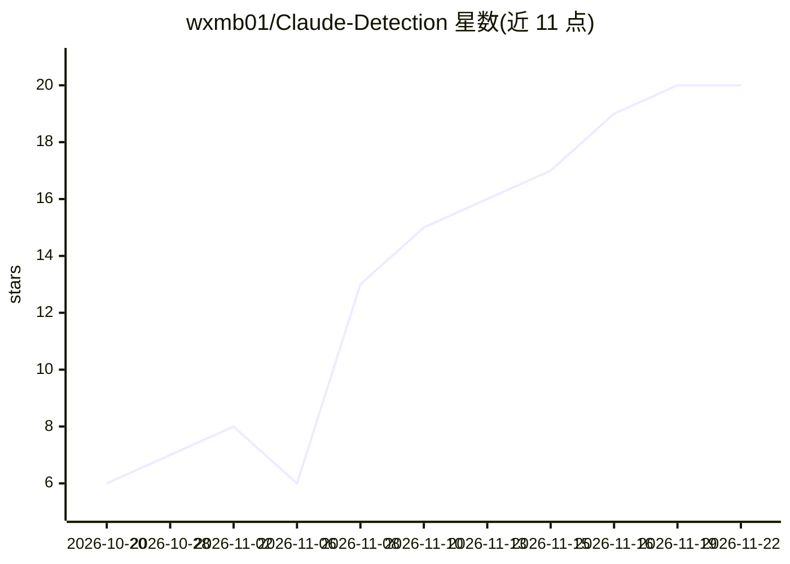

# wxmb01/Claude-Detection

⭐ 20 · Python · MIT · 推送 2026-10-01 · [GitHub](https://github.com/wxmb01/Claude-Detection) · 个人维护 · 中文 README

**检测 Claude API 中转是否掺水的取证工具与 Claude Code Skill**

面向使用 Claude API 中转/代理的用户与开发者，通过服务端难以伪造的行为证据（thinking 签名校验、缓存阈值、参数规则指纹、尾部金丝雀、程序判分新题等约 20 个检测项）判断端点是否存在模型替换、隐藏注入、截断、渠道转手等掺水情况，输出 100 分制证据评分 SCORE.md、结构化 results.json 与原始请求记录。提供 Claude Code Skill、其他 AI 助手、单文件版、命令行四种使用方式；仅需 Python 3.9+ 且不安装依赖，联网检测按档位产生 API 费用。自带本地作弊中转 fake_relay.py 做阳性对照（10 种作弊、5 种渠道模拟）。限制：部分方法未经独立复现，规则表依赖官方文档核对、会随模型更新过期。

## 筛选速览

| 维度 | 判定 | 备注 |
|---|---|---|
| AI 角色 | `ai-ecosystem` | LLM/agent 周边工具 |
| 许可风险 | `permissive` | MIT |
| 部署形态 | `None` |  |
| 模型依赖 | — | README 未给出锁定关系 |
| 硬件要求 | — | 无带数字的原话,不猜 |
| 安装摩擦 | `low` | 无编译、无系统依赖或容器化 |
| 成熟度 | — | 结构信号不足 |

## 能力要点

- 约 20 个检测项基于服务端难以伪造的行为证据（thinking 签名、缓存阈值、参数指纹、金丝雀等）
- 六维证据评分输出 SCORE.md，含覆盖率、一票否决封顶与结论画像
- 本地作弊中转 fake_relay.py 提供 10 种作弊模式阳性对照与 5 种渠道模拟
- 四种使用方式：Claude Code Skill、其他 AI 助手、单文件版、命令行

## 适用场景

- 买了 Claude API 中转服务后核验是否为原装模型、有无注入
- 排查部分请求被偷换或上下文被截断的问题
- 识别中转背后的渠道链（Kiro、Bedrock、Vertex、网关等）

## 场景标签

`模型评测` · 领域:评测与运维

## 证据(README 行号)

> L34: |用便宜的同代模型冒充（如 Sonnet 5.5 冒充 Opus 5.5）|S14 替换指纹 · S3 读取矩阵（只用强证据）|**强**|
> L50: - 跑完检测会生成 `SCORE.md`，按 6 个维度汇总成 **100 分制证据评分**。

## 星数曲线

2026-10-20 6 → 2026-11-22 20（+14）

---
*卡片 v1 · prompt 1.4 · 生成 2026-11-18 · 置信度 high · 依据 README sha `659d059c558c` · [字段定义](../../DATASET.md)*
