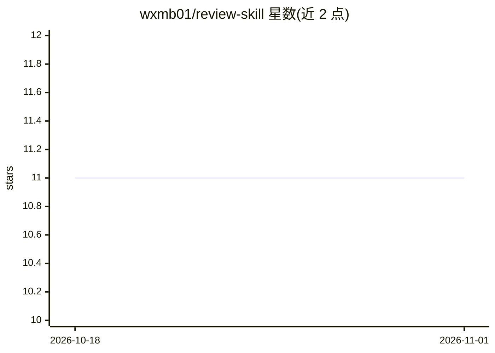

# wxmb01/review-skill

⭐ 11 · PowerShell · MIT · 推送 2026-03-28 · [GitHub](https://github.com/wxmb01/review-skill) · [官网](https://github.com/wxmb01/review-skill/releases/latest) · 个人维护 · 中文 README

**面向 AI agent 的证据型评审技能：PR/项目/文档审查**

以开源 skill 形式交付的评审能力包，供 Codex 等 agent 通过 $review 调用。覆盖三种范围：change（PR/diff 评审，给出合并建议与回归风险）、project（整仓完成度审计与整改路线图）、artifact（设计文档歧义与需求缺口）。提供七种评审模式（code/readiness/architecture/requirements/risk/documentation/project），输出严重度排序的发现、完成度判定、就绪评分卡、风险登记册等。默认对评审对象只读，强调发现需证据支撑。

## 筛选速览

| 维度 | 判定 | 备注 |
|---|---|---|
| AI 角色 | `ai-ecosystem` | LLM/agent 周边工具 |
| 许可风险 | `permissive` | MIT |
| 部署形态 | `library` | 以包/库形式分发 |
| 模型依赖 | — | README 未给出锁定关系 |
| 硬件要求 | — | 无带数字的原话,不猜 |
| 安装摩擦 | `low` | 无编译、无系统依赖或容器化 |
| 成熟度 | — | 结构信号不足 |

## 能力要点

- change/project/artifact 三种范围与七种评审模式
- 发现需证据支撑，输出严重度排序与就绪评分卡
- npx skills add 一条命令安装，含 Codex 本地同步脚本
- 提供中英文概述图与中文介绍视频

## 适用场景

- 让 agent 评审 PR 是否可安全合并
- 对整个仓库做完成度与交付就绪审计
- 审查设计文档的歧义、缺失验收标准与风险

## 场景标签

`代码审查` · 领域:编码与开发

## 证据(README 行号)

> L9:  Evidence-based review for pull requests, whole projects, and technical artifacts.
> L128: npx skills add https://github.com/wxmb01/review-skill --skill review -g -y

## 星数曲线

2026-10-18 11 → 2026-11-01 11（+0）

---
*卡片 v1 · prompt 1.4 · 生成 2026-11-01 · 置信度 high · 依据 README sha `3cd6b05344e9` · [字段定义](../../DATASET.md)*
