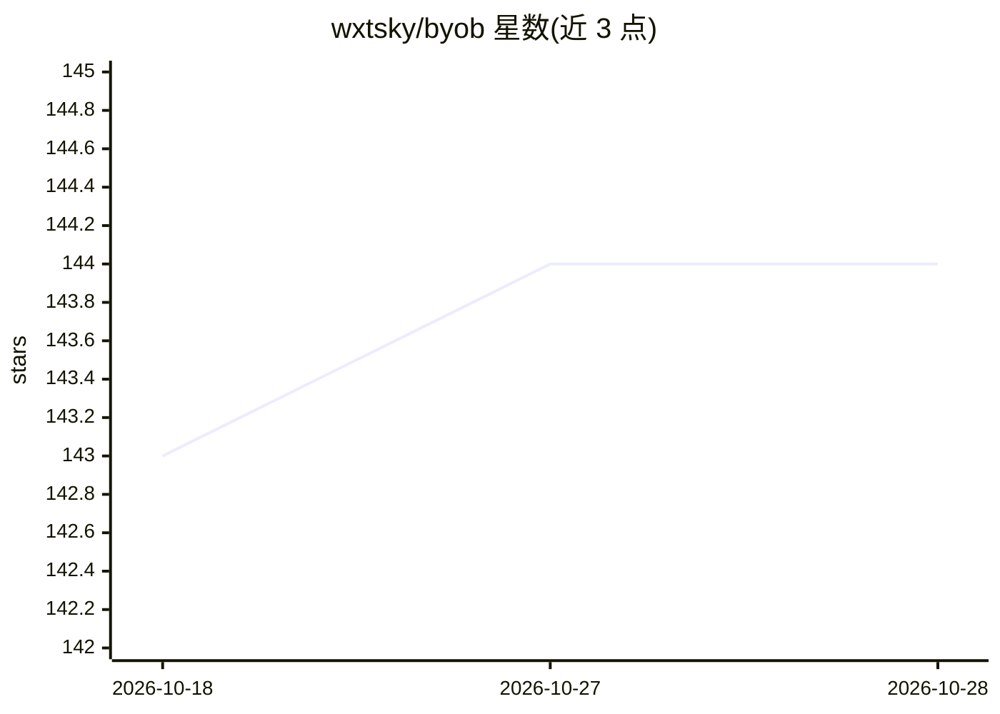

# wxtsky/byob

⭐ 145 · JavaScript · MIT · 推送 2026-09-29 · [GitHub](https://github.com/wxtsky/byob) · [官网](https://github.com/wxtsky/byob) · 个人维护 · 中文 README

**本地 MCP 服务器：让 AI 编码工具直接控制你已登录的 Chrome**

byob 是一个运行在本地的 MCP 服务器，配合 Chrome 扩展（MV3）与 Native Messaging 桥接，使 Claude Code、Cursor、Cline、Windsurf 等 MCP 兼容的 AI 工具能够直接操作用户当前已登录的真实 Chrome 浏览器。链路为 AI tool → MCP(stdio) → bridge(Unix socket) → 扩展 → 标签页（Chrome DevTools Protocol），提供 25 个工具覆盖快照、点击、填表、截图、网络拦截、存储读写等。安全机制包括页面脚本运行在隔离 world、逐站点 allow/deny 策略由用户设定、凭据字段脱敏、browser_evaluate 默认关闭。要求 Node.js ≥ 20、bun 与 Chrome，通过安装脚本或 git clone + bun run setup 安装。

## 筛选速览

| 维度 | 判定 | 备注 |
|---|---|---|
| AI 角色 | `ai-ecosystem` | LLM/agent 周边工具 |
| 许可风险 | `permissive` | MIT |
| 部署形态 | `None` |  |
| 模型依赖 | — | README 未给出锁定关系 |
| 硬件要求 | — | 无带数字的原话,不猜 |
| 安装摩擦 | `low` | 无编译、无系统依赖或容器化 |
| 成熟度 | — | 结构信号不足 |

## 能力要点

- 控制已登录的真实 Chrome，无需 cookie 复制或调试端口
- 25 个 MCP 工具：快照/查找/点击/填表/截图/网络拦截/存储读写等
- 安全机制：隔离 world、用户设定的站点 allow/deny 策略、凭据字段脱敏、零外发流量
- 支持 macOS/Windows/Linux，Windows 写注册表注册 Native Messaging host

## 适用场景

- 让 AI 编码工具读取我已登录站点的页面并执行操作
- 以真实浏览器通过机器人检测执行自动化任务
- 通过站点策略限制 AI 可访问的网站范围

## 场景标签

`浏览器自动化` · 领域:效率与自动化

## 证据(README 行号)

> L11: byob is a local MCP server that lets AI coding tools (Claude Code, Cursor, Cline, Windsurf, etc.) directly control 
> L201: AI tool → byob-mcp → byob-bridge → Chrome extension → your tab

## 星数曲线

2026-10-18 143 → 2026-10-28 144（+1）

---
*卡片 v1 · prompt 1.4 · 生成 2026-10-22 · 置信度 high · 依据 README sha `13ca2958ebe6` · [字段定义](../../DATASET.md)*
