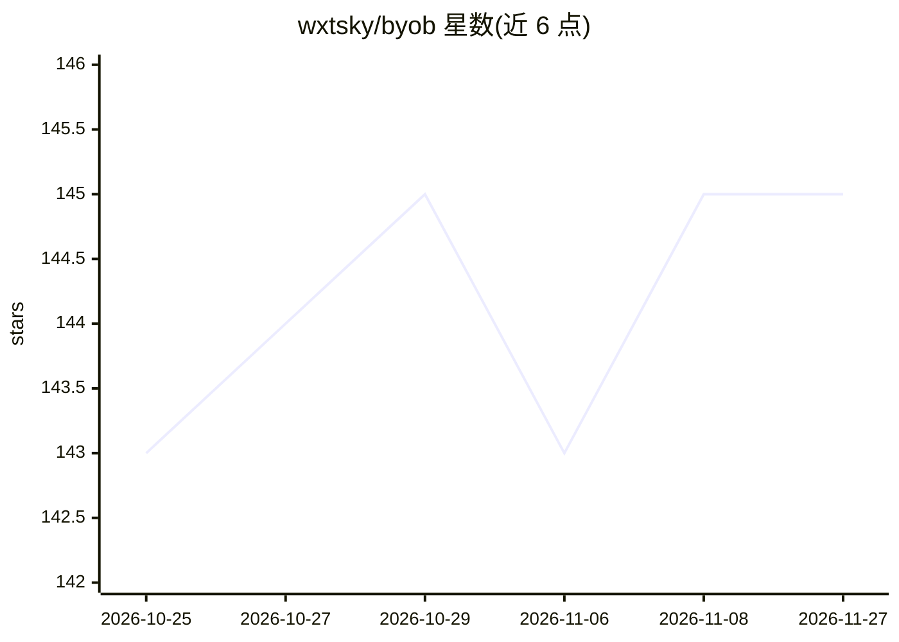

# wxtsky/byob

⭐ 145 · TypeScript · MIT · 推送 2026-11-24 · [GitHub](https://github.com/wxtsky/byob) · [官网](https://github.com/wxtsky/byob) · 个人维护 · 中文 README

**本地 MCP 服务器：让 AI 编码工具控制你已登录的 Chrome**

byob 通过 Chrome MV3 扩展加 Native Messaging 桥接，向 Claude Code、Cursor、Cline、Windsurf 等 MCP 客户端暴露约 20 个浏览器控制工具：快照、点击、填表、截图、读取 PDF/cookie、拦截网络、录制视频、执行 JS 等，元素用 ref 或 CSS 选择器定位。因复用用户真实浏览器，已登录会话直接可用，且不开放远程调试端口。全部通信留在本地；需 Node.js ≥20、bun、Chrome，安装脚本交互完成扩展加载与 MCP 注册。

## 筛选速览

| 维度 | 判定 | 备注 |
|---|---|---|
| AI 角色 | `ai-ecosystem` | LLM/agent 周边工具 |
| 许可风险 | `permissive` | MIT |
| 部署形态 | `None` |  |
| 模型依赖 | — | README 未给出锁定关系 |
| 硬件要求 | — | 无带数字的原话,不猜 |
| 安装摩擦 | `low` | 无编译、无系统依赖或容器化 |
| 成熟度 | — | 结构信号不足 |

## 能力要点

- 约 20 个 MCP 浏览器工具，含网络拦截、录制、常驻 userscript 等扩展工具
- 复用用户已登录的真实 Chrome，无需拷贝 cookie 或开放调试端口
- Claude Code Code Mode 下以 JavaScript 脚本批量调用工具，结果可存文件不入上下文
- 脚本隔离世界运行、ref 绑定节点 id、按会话分 tab，Chrome 关闭时进程自动退出

## 适用场景

- 让 AI 工具读取和操作我已登录的网页（Gmail、GitHub、Twitter 等）
- 用 AI 批量访问产品页、按 CSV 填表单并提交
- 抓取带登录态的页面截图、PDF 内容或 cookie 供 curl 使用
- 遇到验证码或支付确认时把 tab 交还给我手动处理

## 场景标签

`浏览器自动化` · 领域:效率与自动化

## 证据(README 行号)

> L11: byob is a local MCP server that lets AI coding tools (Claude Code, Cursor, Cline, Windsurf, etc.) directly control 
> L251: AI tool → byob-mcp → byob-bridge → Chrome extension → your tab

## 星数曲线

2026-10-25 143 → 2026-11-27 145（+2）

---
*卡片 v1 · prompt 1.4 · 生成 2026-11-27 · 置信度 high · 依据 README sha `7d108cde4708` · [字段定义](../../DATASET.md)*
