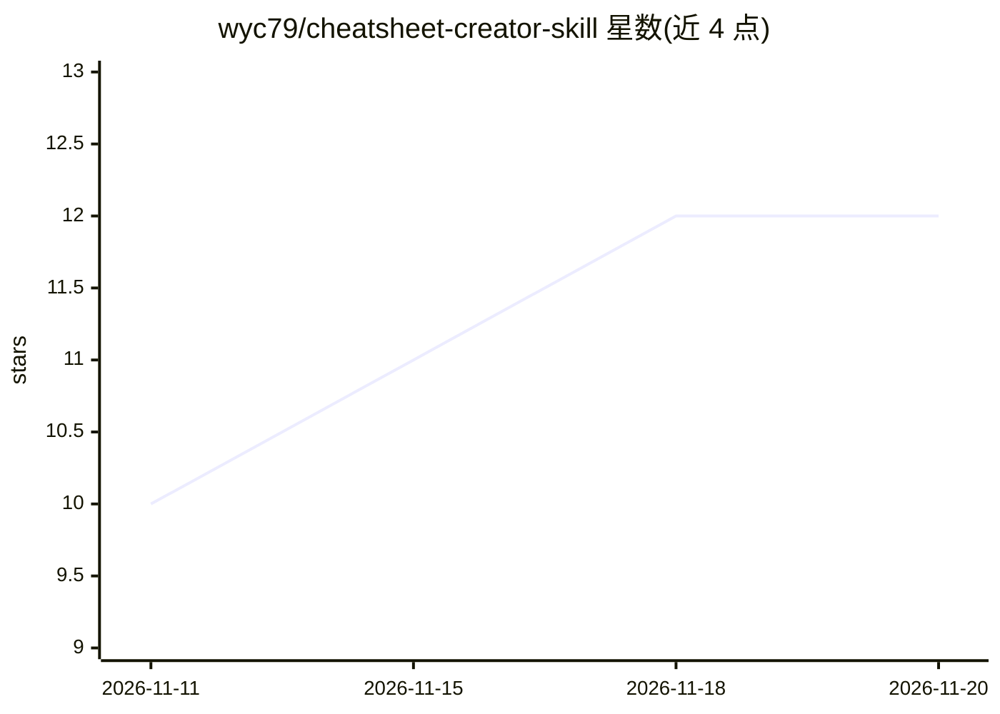

# wyc79/cheatsheet-creator-skill

⭐ 12 · MIT · 推送 2026-08-11 · [GitHub](https://github.com/wyc79/cheatsheet-creator-skill) · 个人维护

**面向学生的 agent 技能：从课程材料生成复习速查表**

一个 AI agent 技能（SKILL.md），读取讲义、作业与往年试卷，生成两份 markdown 输出：精简速查表与带斜体出处引用（回指幻灯片/作业/试卷位置）的扩展版。针对数学/理科（公式、证明、定理）与计算机/工程（代码、算法）调优。逐文件处理以避免超出上下文窗口；支持 PDF（含扫描件）、PPTX、DOCX、手写笔记图片。生成后执行自检：由独立 agent 审核题目可解性，并通过消融式自测（无表/仅概念/完整表三种条件）评估速查表本身的贡献，再据此做一轮修订。

## 筛选速览

| 维度 | 判定 | 备注 |
|---|---|---|
| AI 角色 | `ai-native` | 本体是模型或模型工具 |
| 许可风险 | `permissive` | MIT |
| 部署形态 | `library` | 以包/库形式分发 |
| 模型依赖 | — | README 未给出锁定关系 |
| 硬件要求 | — | 无带数字的原话,不猜 |
| 安装摩擦 | `low` | 无编译、无系统依赖或容器化 |
| 成熟度 | — | 结构信号不足 |

## 能力要点

- 输出精简版与带出处引用的扩展版两份 markdown
- 支持 PDF（含扫描/手写）、PPTX、DOCX、手写图片输入
- 逐文件处理以避免超出上下文窗口
- 生成后自检与消融式自测（三种条件对比）驱动修订

## 适用场景

- 期末备考时从全套课程材料生成速查表
- 把手写笔记与试卷整理成带出处的复习指南
- 按目标页数/规则（如仅公式）定制速查表

## 场景标签

`文档解析` · 领域:知识与检索

## 证据(README 行号)

> L3: AI agent skill for creating cheatsheets based on lecture notes, homeworks, and past exams.
> L5: Outputs two markdown files — a concise cheatsheet and an expanded version with italic source references back to the 

## 星数曲线

2026-11-11 10 → 2026-11-20 12（+2）

---
*卡片 v1 · prompt 1.4 · 生成 2026-11-18 · 置信度 high · 依据 README sha `50845fa44a92` · [字段定义](../../DATASET.md)*
