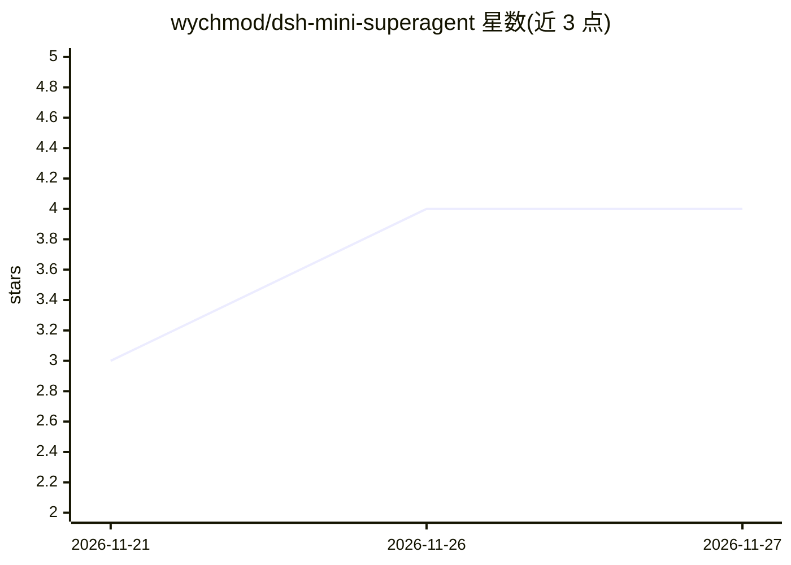

# wychmod/dsh-mini-superagent

⭐ 4 · JavaScript · MIT · 推送 2026-11-21 · [GitHub](https://github.com/wychmod/dsh-mini-superagent) · [官网](https://wychmod.github.io/dsh-mini-superagent/) · 个人维护 · 中文 README

**DSH 插件：主会话向后台子会话派发任务并回收报告**

DeepSeek Harness 的任务派发与工作台插件：主会话提交自包含任务简报给独立后台子会话执行，报告以插件消息自动回流，派发只登记后立即返回不占用 step。提供 10 个 dispatch_* 工具，支持单批 1–16 项任务、默认 6 路并发排队、批次依赖、续派与交接，侧边栏 Web 看板展示并发/排队/失败信息，任务账本落盘 tasks.json 支持重启恢复。纯 ESM、零运行时依赖，仅要求 Node 22/24 与 DSH>=0.2.1-rc.2。

## 筛选速览

| 维度 | 判定 | 备注 |
|---|---|---|
| AI 角色 | `ai-ecosystem` | LLM/agent 周边工具 |
| 许可风险 | `permissive` | MIT |
| 部署形态 | `library` | 以包/库形式分发 |
| 模型依赖 | — | README 未给出锁定关系 |
| 硬件要求 | — | 无带数字的原话,不猜 |
| 安装摩擦 | `low` | 无编译、无系统依赖或容器化 |
| 成熟度 | — | 结构信号不足 |

## 能力要点

- 非阻塞任务派发：dispatch_launch 登记后立即返回，报告自动回流主会话
- 批量 1–16 项派发，默认 6 路并发，队列自动补位，支持批次依赖
- worker 会话可续派/追问/交接（continue_task_id、handoff_from）
- Web 派发工作台与 tasks.json v4 账本，支持重启恢复与退休留痕

## 适用场景

- 在 DSH 里把重构、批量处理等独立任务派给后台子会话并行执行
- 批量跑互不依赖的子任务并控制并发数
- 追踪派发任务的进度、失败原因并按需取消/重试

## 场景标签

`多智能体` · 领域:Agent 开发

## 证据(README 行号)

> L3:  DeepSeek Harness 任务派发与工作台插件
> L16: > **In English**: `dsh-mini-superagent` is a task dispatch and workbench plugin for DeepSeek Harness (DSH): the mai
> L98: 要求：DSH `>=0.2.1-rc.2`；Node `^22.19.0 || >=24.0.0`；无运行时依赖、无构建步骤。

## 星数曲线

2026-11-21 3 → 2026-11-27 4（+1）

---
*卡片 v1 · prompt 1.4 · 生成 2026-11-21 · 置信度 mid · 依据 README sha `abebeebaddbe` · [字段定义](../../DATASET.md)*
