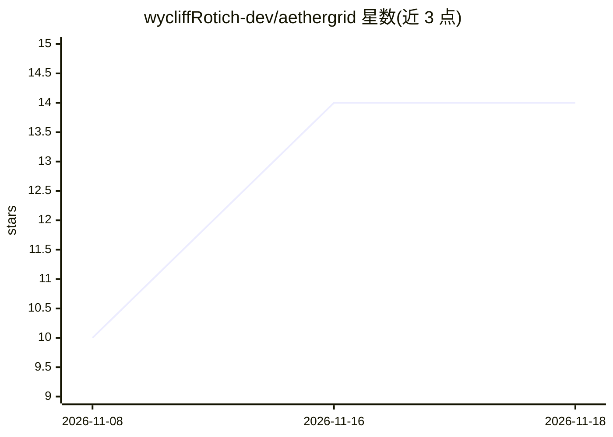

# wycliffRotich-dev/aethergrid

⭐ 14 · Python · MIT · 推送 2026-11-17 · [GitHub](https://github.com/wycliffRotich-dev/aethergrid) · [官网](https://aethergrid.co.ke/) · 个人维护

**面向团队的分布式 AI 作业调度控制平面，租户隔离与租约故障恢复**

用 Python/FastAPI/PostgreSQL/React/Docker 构建的 AI 工作负载编排控制平面：将作业按资源需求与约束匹配到计算节点，管理排队、调度、运行、重试、取消的完整生命周期。核心机制是时间限定的租约实现单一所有者、按租户隔离读写、API key 最小权限、升级前在种子数据上演练，并有 ADR 记录每个非显而易见的决策。面向需要审计的运行 AI 负载的平台与基础设施团队；公开演示仍在建设中。

## 筛选速览

| 维度 | 判定 | 备注 |
|---|---|---|
| AI 角色 | `ai-ecosystem` | LLM/agent 周边工具 |
| 许可风险 | `permissive` | MIT |
| 部署形态 | `self-host` | docker 或自建部署 |
| 模型依赖 | — | README 未给出锁定关系 |
| 硬件要求 | — | 无带数字的原话,不猜 |
| 安装摩擦 | `low` | 无编译、无系统依赖或容器化 |
| 成熟度 | `idea` | |

## 能力要点

- 时间限定租约保证作业单一所有者，过期所有者无法结束作业
- Postgres 层强制租户隔离，读按调用者租户限定范围
- 除健康探针外所有路由要求 API key，扩权操作需显式 scope
- 升级前用上一版本种子数据演练并比对行、schema 与 API

## 适用场景

- 一个集群多团队/多客户共享，各自租户内运行 AI 作业
- 节点掉线、worker 重启后自动恢复作业与资源状态
- 需要可审计决策记录与升级演练的合规场景

## 场景标签

`工作流自动化` `MLOps` · 领域:效率与自动化

## 证据(README 行号)

> L3:  AetherGrid is the control plane for AI workloads. It places work on the compute you already own, and it keeps one r
> L15: AetherGrid takes workloads, matches them against available compute nodes by resource requirements and constraints, 
> L43: For platform and infrastructure teams, one cluster serves several teams

## 星数曲线

2026-11-08 10 → 2026-11-18 14（+4）

---
*卡片 v1 · prompt 1.4 · 生成 2026-11-18 · 置信度 mid · 依据 README sha `771e25e0efcc` · [字段定义](../../DATASET.md)*
