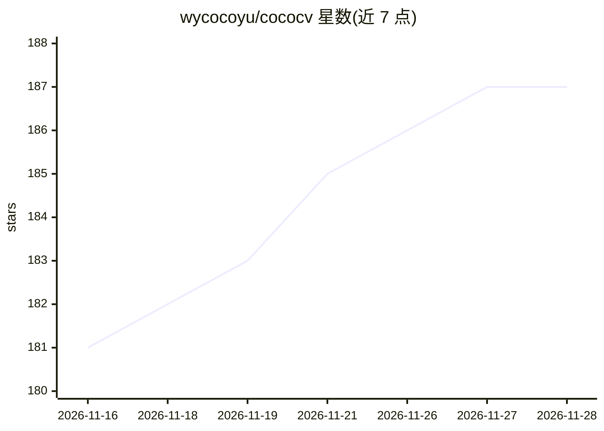

# wycocoyu/cococv

⭐ 187 · Python · MIT · 推送 2026-11-19 · [GitHub](https://github.com/wycocoyu/cococv) · [官网](https://cococv.cn) · 个人维护 · 中文 README

**面向中文求职的全栈 AI 简历平台：对话生成、诊断与 LaTeX 排版**

全栈 Web 应用（React+FastAPI），面向中文求职场景：支持一句话对话生成简历、上传 PDF/图片经 glm-ocr 解析导入、可解释诊断与 ATS 兼容检查、自然语言增量改写、双栏可视化排版与服务端 XeLaTeX 编译导出 PDF。AI 层由 DeepSeek（对话/诊断/结构化生成）与智谱 GLM（OCR）驱动，需自备 API key。另提供可装入 Codex、Claude Code 等 Agent 的本地 CLI Skill（免 XeLaTeX 依赖）。支持 Docker 一键部署与本地源码运行，内置 27 套模板。

## 筛选速览

| 维度 | 判定 | 备注 |
|---|---|---|
| AI 角色 | `ai-native` | 本体是模型或模型工具 |
| 许可风险 | `permissive` | MIT |
| 部署形态 | `self-host` | docker 或自建部署 |
| 模型依赖 | locked-api |  |
| 硬件要求 | — | 无带数字的原话,不猜 |
| 安装摩擦 | `low` | 无编译、无系统依赖或容器化 |
| 成熟度 | — | 结构信号不足 |

## 能力要点

- 一句话生成 / PDF 图片导入 / LaTeX 模板三种起点
- 可解释诊断与 ATS 兼容检查清单，逐条引用简历原文
- 服务端 XeLaTeX 高清编译并做 ATS 字符归一化
- Agent Skill 可装入 Codex / Claude Code 等工具本地运行，零 LaTeX 依赖

## 适用场景

- 和 AI 对话把经历生成一份高清 LaTeX 简历
- 上传旧简历对照目标岗位 JD 做诊断与改写
- 在 Codex / Claude Code 里用技能命令本地生成并导出简历

## 场景标签

`AI 写作` · 领域:内容生成

## 证据(README 行号)

> L22: **CocoCV（cococv.cn，原 Resume-Agent）** 是一个面向中文求职场景的全栈 AI 简历平台，打通了从 **一句话对话生成 / PDF 与图片导入 → 可解释简历诊断与 ATS 检查 → 自然语言增量改写
> L103: |**AI 模型层**|DeepSeek 官方（`deepseek-flash` / `deepseek-v4-pro`）· 智谱 GLM（`glm-ocr` / `glm-4.6v`）|DeepSeek 负责对话、诊断与结构化

## 星数曲线

2026-11-16 181 → 2026-11-28 187（+6）

---
*卡片 v1 · prompt 1.4 · 生成 2026-11-17 · 置信度 high · 依据 README sha `c96c08130258` · [字段定义](../../DATASET.md)*
