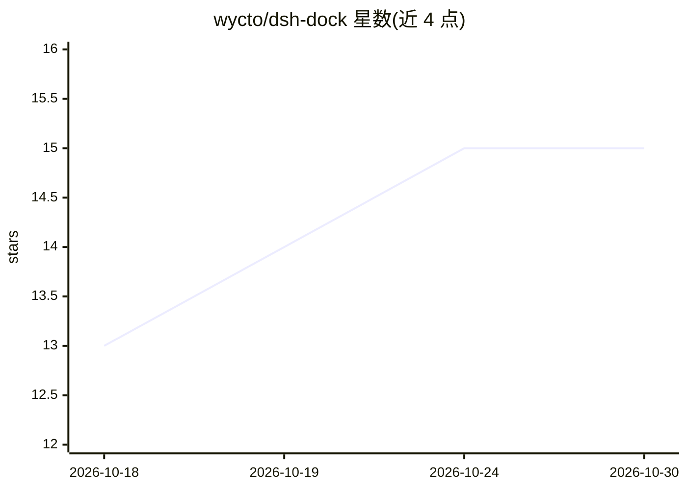

# wycto/dsh-dock

⭐ 15 · JavaScript · MIT · 推送 2026-10-28 · [GitHub](https://github.com/wycto/dsh-dock) · [官网](https://www.npmjs.com/package/dsh-dock) · 个人维护 · 中文 README

**DeepSeek Harness 插件：一个面板统一管理用量记账、模型与通知等小功能**

DeepSeek Harness（dsh）的功能坞插件：以模块化面板聚合十余项功能——LLM API 用量记录（自定义单价、分时价、峰谷计价、CSV 导出与多维图表）、模型设置与提供商管理（OpenAI 兼容、Anthropic Messages，API Key 存本机凭据库）、账户余额展示、19 种任务动画、任务通知（钉钉/飞书群机器人推送）、语音朗读（浏览器 Web Speech API）、图片理解代理、账号密码远程访问网关、手机适配与 10 款小游戏。每个功能独立开关、错误隔离、即插即用。要求 dsh 环境与 Node.js 18+，经 dsh plugin 以 npm 或源码 link: 方式安装。

## 筛选速览

| 维度 | 判定 | 备注 |
|---|---|---|
| AI 角色 | `ai-ecosystem` | LLM/agent 周边工具 |
| 许可风险 | `permissive` | MIT |
| 部署形态 | `library` | 以包/库形式分发 |
| 模型依赖 | locked-api |  |
| 硬件要求 | — | 无带数字的原话,不猜 |
| 安装摩擦 | `low` | 无编译、无系统依赖或容器化 |
| 成熟度 | — | 结构信号不足 |

## 能力要点

- 用量记账支持自定义单价、多段分时价与法定节假日口径，含 9 张 KPI 卡与多维图表、CSV 导出
- 模型提供商增删改（OpenAI 兼容、Anthropic Messages 等），API Key 写入本机凭据库
- 任务通知含钉钉/飞书群机器人推送（宿主直发）与浏览器语音播报
- 账号密码登录的远程访问网关，主实例保持仅监听 127.0.0.1

## 适用场景

- 统计 LLM API 调用 Token 与费用，按自填单价和分时价计费
- 在 dsh 中管理自定义模型 Provider 与查看各账户余额
- 任务完成后通过钉钉/飞书群机器人接收推送
- 手机或局域网设备远程访问同一 dsh 实例

## 场景标签

`LLM 可观测性` · 领域:评测与运维

## 证据(README 行号)

> L6: **DeepSeek Harness 功能坞插件**：用一张管理面板，统一注册、开关所有小功能。
> L49: dsh-dock 是 DeepSeek Harness（dsh）的插件，装进 dsh 的 `web` profile（dsh 把插件当作 profile 的一层
> L101: 1. 启动 dsh：`npx @deepseek-ai/dsh web`

## 星数曲线

2026-10-18 13 → 2026-10-30 15（+2）

---
*卡片 v1 · prompt 1.4 · 生成 2026-10-30 · 置信度 high · 依据 README sha `4686eb341f88` · [字段定义](../../DATASET.md)*
