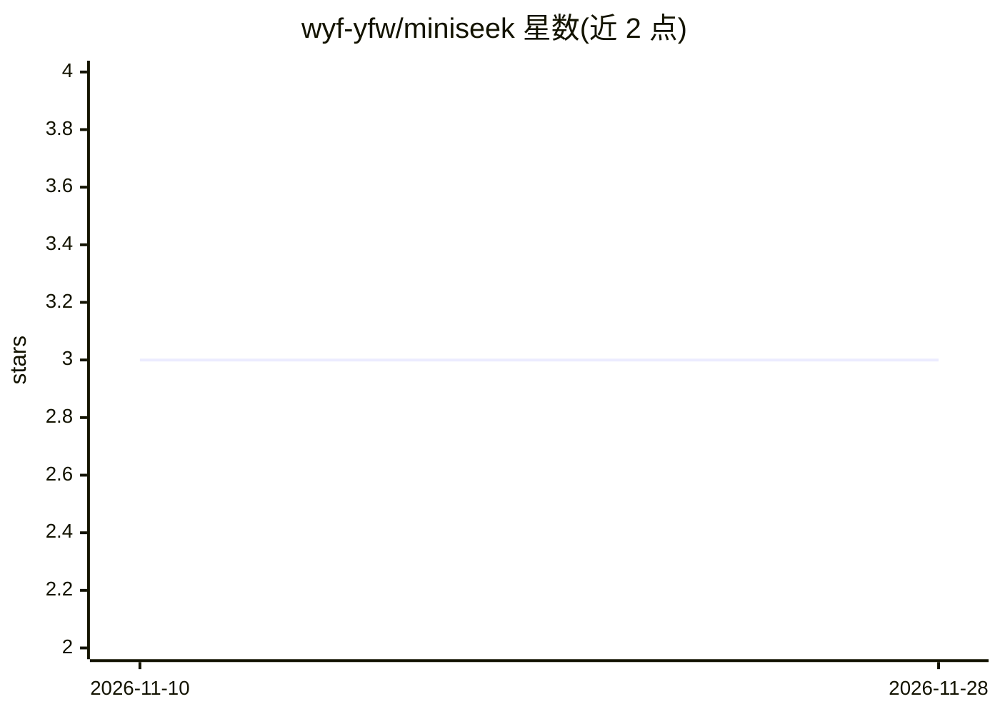

# wyf-yfw/miniseek

⭐ 3 · Python · MIT · 推送 2026-11-05 · [GitHub](https://github.com/wyf-yfw/miniseek) · [官网](https://huggingface.co/collections/wyf-yfw/miniseek-6adc765159d38ab3236c49af) · 个人维护 · 中文 README

**单卡 RTX 3090 从零训练的 DeepSeek-V4.1-Flash 缩小版语言模型**

用 PyTorch 在单张 RTX 3090（24GB）上从 0 训练 MiniSeek-V1（187M 参数，每 token 激活 33M），层内算子按 DeepSeek-V4.1-Flash 论文与官方代码实现，覆盖 CED、压缩稀疏注意力 CSA2、mHC、MoE、Engram 记忆与 DSpark 投机解码。提供预训练/SFT/草稿头训练脚本、Web UI（训练、对话、评测、数据清洗、专家负载）与逐算子等价测试；差异包括 KV 全用 BF16、暂无视觉分支、尺寸缩小。模型权重与训练数据发布在 Hugging Face。

## 筛选速览

| 维度 | 判定 | 备注 |
|---|---|---|
| AI 角色 | `ai-native` | 本体是模型或模型工具 |
| 许可风险 | `permissive` | MIT |
| 部署形态 | `None` |  |
| 模型依赖 | — | README 未给出锁定关系 |
| 硬件要求 | — | 无带数字的原话,不猜 |
| 安装摩擦 | `low` | 无编译、无系统依赖或容器化 |
| 成熟度 | — | 结构信号不足 |

## 能力要点

- 单张 RTX 3090 完整走通数据清洗→预训练→SFT→投机解码→评测流程
- 层内算子对齐 DeepSeek-V4.1-Flash，附官方推理代码移植与逐算子等价测试
- FastAPI Web UI 覆盖训练 Task、对话续写、架构可视化与评测
- 已发布 V1/M0.1/D0.1 等 8 个模型权重与预训练/SFT 数据集

## 适用场景

- 在个人单卡显卡上从零训练并复现现代 LLM 架构
- 对照代码与单测学习 MoE、稀疏注意力、投机解码等部件实现
- 训练小尺寸对话模型并做 C-Eval/CMMLU/GSM8K 评测

## 场景标签

`模型训练` `模型评测` · 领域:评测与运维

## 证据(README 行号)

> L13: * 此开源项目用 PyTorch 原生代码，在单张 RTX 3090 上从 0 训练 **MiniSeek-V1**：层实现对齐 DeepSeek-V4.1-Flash 的超小语言模型，主干 + Engram 共 **187M**
> L36: - Web UI（FastAPI，`:7860`）：训练 Task、对话、续写、架构图、评测（默认 tinyBenchmarks；可选 C-Eval / CMMLU / GSM8K）、排行榜、数据清洗、专家负载。

## 星数曲线

2026-11-10 3 → 2026-11-28 3（+0）

---
*卡片 v1 · prompt 1.4 · 生成 2026-11-21 · 置信度 high · 依据 README sha `7971759c630d` · [字段定义](../../DATASET.md)*
