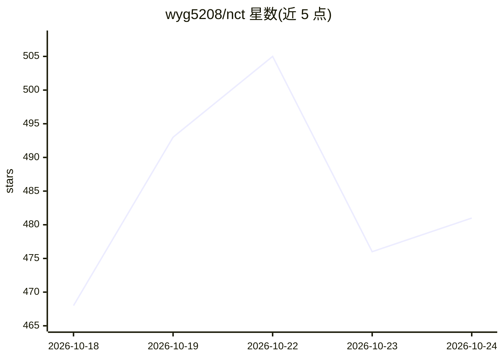

# wyg5208/nct

⭐ 493 · Python · MIT · 推送 2026-08-01 · [GitHub](https://github.com/wyg5208/nct) · [官网](https://neuroconscious.link/) · 组织维护 · 中文 README

**融合神经科学理论的意识建模研究框架，面向科研**

基于 PyTorch 的神经形态意识建模框架：以多头注意力实现全局工作空间、Transformer-STDP 混合学习、预测编码作为解码目标、注意力流实时计算整合信息 Φ，并含 MCS 多约束满足框架与 CATS-NCT 概念抽象扩展。附 Streamlit 可视化仪表盘（Φ/自由能/注意力监控）、实验脚本与 EEG 教育场景研究（EEGNet 特征使 Φ 显著）。两篇论文在投 IEEE Trans. Affective Computing，代码供科研复现。

## 筛选速览

| 维度 | 判定 | 备注 |
|---|---|---|
| AI 角色 | `ai-native` | 本体是模型或模型工具 |
| 许可风险 | `permissive` | MIT |
| 部署形态 | `library` | 以包/库形式分发 |
| 模型依赖 | — | README 未给出锁定关系 |
| 硬件要求 | — | 无带数字的原话,不猜 |
| 安装摩擦 | `medium` | 含编译或系统依赖之一 |
| 成熟度 | — | 结构信号不足 |

## 能力要点

- 注意力全局工作空间、Transformer-STDP、预测编码、Φ 计算四类机制实现
- MCS 多约束满足意识建模框架与 CATS-NCT 概念抽象扩展
- Streamlit 实时可视化仪表盘，支持中英双语与 CSV 导出
- 提供实验复现脚本（run_all_experiments）与统计显著性分析

## 适用场景

- 复现意识理论（GWT/IIT/预测编码）的计算模型与实验
- 教育场景下用 EEG 深度学习特征做认知状态监测研究
- 在自定义数据集上运行 Φ 值与自由能等指标的量化实验

## 场景标签

`科研工具` · 领域:学习与行业

## 证据(README 行号)

> L19: NeuroConscious Transformer (NCT) is a **next-generation neuromorphic consciousness architecture** that reconstructs
> L22: 2. **Transformer-STDP Hybrid Learning** - Globally modulated synaptic plasticity
> L26: 6. **Φ Calculator from Attention Flow** - Real-time integrated information computation

## 星数曲线

2026-10-18 468 → 2026-10-24 481（+13）

---
*卡片 v1 · prompt 1.4 · 生成 2026-10-21 · 置信度 mid · 依据 README sha `68688faf3216` · [字段定义](../../DATASET.md)*
