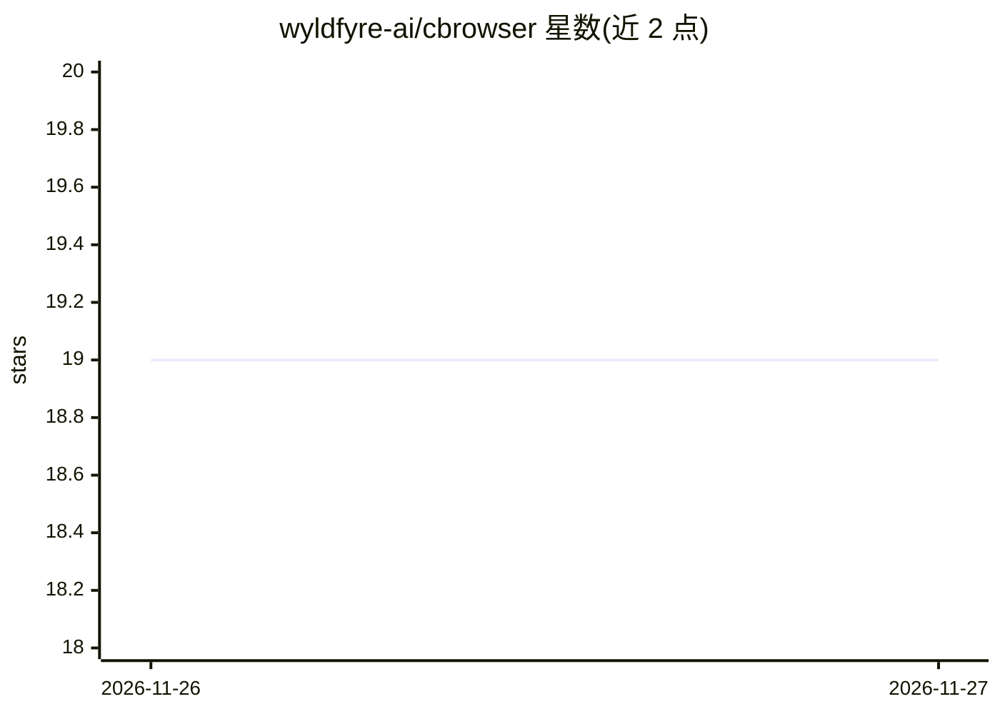

# wyldfyre-ai/cbrowser

⭐ 19 · TypeScript · NOASSERTION · 推送 2026-11-24 · [GitHub](https://github.com/wyldfyre-ai/cbrowser) · [官网](https://cbrowser.ai) · 组织维护

**面向开发者与测试人员的认知化浏览器自动化 CLI/库/MCP 工具集**

基于 Playwright 的浏览器自动化工具，以 npm 全局包、CLI、库与本地 MCP 服务器（130 个工具加 7 个本地工具）四种形态提供。核心机制包括八层 Sequential Transport Chain（认知负荷、决策、运动、挫败感、可读性等）按 persona 计算页面难度并预测放弃风险，21 个内置 persona 模拟不同用户特质（耐心、工作记忆、风险容忍等，附研究文献）。基础操作免费；cognitive-journey、explore、compare-personas 等命令需 Anthropic API key，每次步骤为一次模型调用。要求 Node.js 20.19+/22.12+，安装时下载 Chromium。

## 筛选速览

| 维度 | 判定 | 备注 |
|---|---|---|
| AI 角色 | `ai-ecosystem` | LLM/agent 周边工具 |
| 许可风险 | `permissive` | NOASSERTION |
| 部署形态 | `desktop` | 安装包/桌面程序 |
| 模型依赖 | locked-api |  |
| 硬件要求 | — | 无带数字的原话,不猜 |
| 安装摩擦 | `low` | 无编译、无系统依赖或容器化 |
| 成熟度 | — | 结构信号不足 |

## 能力要点

- 八层认知传输链计算页面难度并预测用户放弃风险
- 21 个内置 persona，特质量表引用 HCI/心理学研究文献
- 130 个 MCP 工具，支持 stdio 本地 MCP 服务器
- AI Friendliness 套件：agent-ready 审计、llms.txt 生成、remediation 补丁

## 适用场景

- 按 persona 审计网站的可用性与无障碍体验
- 评估网站对 AI agent 的可感知性与可操作性
- 生成注意力热力图与旅程可视化报告
- 自动化端到端测试与缺陷排查

## 场景标签

`浏览器自动化` · 领域:效率与自动化

## 证据(README 行号)

> L3: > **Browser automation that thinks like your users.** 130 MCP tools, 21 built-in personas, a CLI, and a library. It 
> L72: - `npx cbrowser mcp-server` (stdio) now registers the same tool set as the hosted server, 130 tools plus 7 local-on
> L37: |Free, no key|Needs an Anthropic API key (each step is a model call)|

## 星数曲线

2026-11-26 19 → 2026-11-27 19（+0）

---
*卡片 v1 · prompt 1.4 · 生成 2026-11-26 · 置信度 mid · 依据 README sha `230529b53ec7` · [字段定义](../../DATASET.md)*
