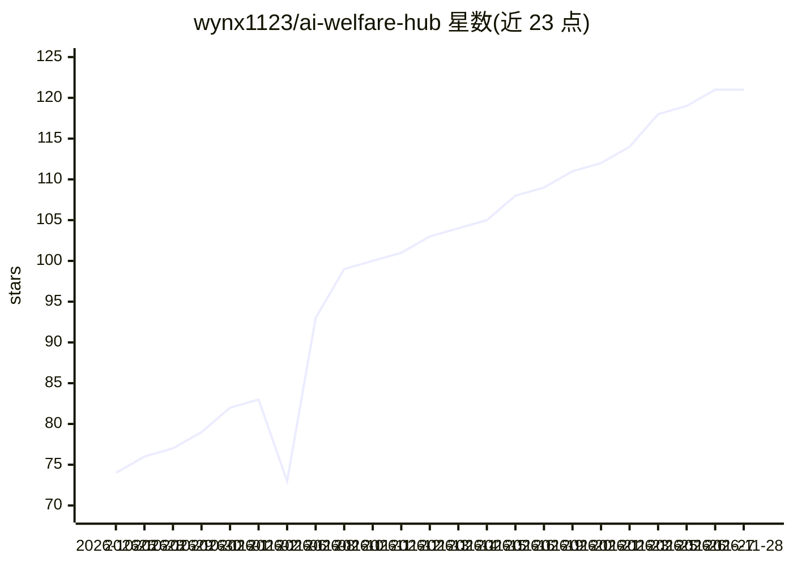

# wynx1123/ai-welfare-hub

⭐ 121 · JavaScript · 推送 2026-11-27 · [GitHub](https://github.com/wynx1123/ai-welfare-hub) · 个人维护 · 中文 README

**面向找免费 AI API 额度用户的公益站/中转站导航清单**

收录 59 个提供注册赠送、邀请奖励或每日签到额度的 AI 公益站与 New API 中转站的导航仓库。数据由 GitHub Actions 每 6 小时（站点每 24 小时）自动探活抓取，输出在线状态、首日理论上限、接口协议与模型数表格，并逐站展开注册方式、额度续领政策、Base URL 接入说明与风险提示。纯静态、零依赖，可 fork 复用；明确声明额度是面板数值而非可提现现金，且部分注册链接含邀请参数。

## 筛选速览

| 维度 | 判定 | 备注 |
|---|---|---|
| AI 角色 | `ai-knowledge` | 知识聚合/清单类 |
| 许可风险 | `none` | — |
| 部署形态 | `None` |  |
| 模型依赖 | — | README 未给出锁定关系 |
| 硬件要求 | — | 无带数字的原话,不猜 |
| 安装摩擦 | `low` | 无编译、无系统依赖或容器化 |
| 成熟度 | — | 结构信号不足 |

## 能力要点

- 收录 59 个公益站/中转站，GitHub Actions 每 6 小时自动探活更新状态
- 逐站登记注册奖励、邀请奖励、每日签到与接口协议（anthropic/openai）
- 明确额度口径：首日理论上限非无条件到账、积分不折算美元
- 纯静态零依赖，数据来自 data/sites.json 可 fork 自用

## 适用场景

- 想免费体验 Claude Code / Codex / Cursor 兼容接口时找可用站点
- 对比各公益站的注册奖励与签到续额规则
- 需要一个持续更新存活状态的中转站清单页面

## 场景标签

`精选清单` · 领域:学习与行业

## 证据(README 行号)

> L10: **当前收录 59 个站点**。按“注册奖励 + 邀请奖励 + 当日签到”的登记口径，美元计价站首日理论上限合计约 **$4108.50**；它不是无条件到账金额，也不代表可提现现金。
> L12: 本项目面向正在寻找 Claude Code、Codex、Cursor、OpenAI 兼容接口或免费 API 体验额度的用户。站点每 24 小时自动探活，但“在线”只代表探测时入口或公开接口可访问，不保证注册、模型调用、余额发放和上
> L161: 以下逐站说明根据 data/sites.json 生成，重点区分注册门槛、奖励条件、接口协议和风险限制。未登记不等于不存在；遇到“待确认”时，以站内首页、控制台和公告为准。

## 星数曲线

2026-10-26 74 → 2026-11-28 121（+47）

---
*卡片 v1 · prompt 1.4 · 生成 2026-11-28 · 置信度 high · 依据 README sha `ca6c9c53b277` · [字段定义](../../DATASET.md)*
