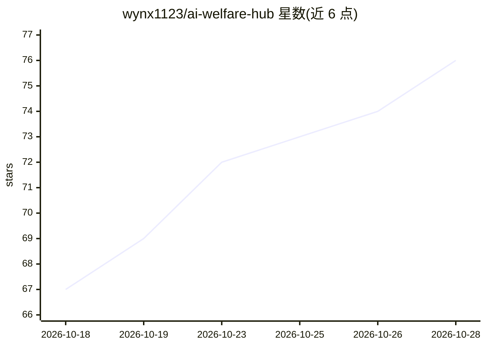

# wynx1123/ai-welfare-hub

⭐ 77 · JavaScript · 推送 2026-10-28 · [GitHub](https://github.com/wynx1123/ai-welfare-hub) · 个人维护 · 中文 README

**AI 公益站/中转站导航清单：自动探活 19 个免费额度站点**

收录 19 个 Claude Code / Codex / GPT / Gemini 免费额度公益站与 New API 中转站，逐站说明注册门槛、奖励构成（注册赠送/邀请/每日签到）、接口协议（anthropic/openai 兼容）、Base URL 与风险限制。GitHub Actions 每 6 小时自动探活并更新存活状态快照，站点详情由 data/sites.json 生成。README 明确披露邀请链接参数、额度口径（美元计价不可提现）与状态探测局限。纯静态页面，可 fork。

## 筛选速览

| 维度 | 判定 | 备注 |
|---|---|---|
| AI 角色 | `ai-knowledge` | 知识聚合/清单类 |
| 许可风险 | `none` | — |
| 部署形态 | `None` |  |
| 模型依赖 | — | README 未给出锁定关系 |
| 硬件要求 | — | 无带数字的原话,不猜 |
| 安装摩擦 | `low` | 无编译、无系统依赖或容器化 |
| 成熟度 | — | 结构信号不足 |

## 能力要点

- 收录 19 个公益站/中转站，含首日额度与协议登记
- GitHub Actions 每 6 小时自动探活更新存活状态
- 逐站披露注册门槛、额度构成、Base URL 与风险提示
- 明确披露邀请链接参数与额度统计口径

## 适用场景

- 找能免费调用 Claude Code / Codex 的公益站并比较额度
- 查看各中转站支持的协议（anthropic/openai）与接入地址
- 跟踪站点存活状态，判断哪些站当前在线

## 场景标签

`精选清单` · 领域:学习与行业

## 证据(README 行号)

> L3: > 公益站 + New API 中转站合集：注册送额度、每日签到、免费调 Claude / GPT / Gemini，自动探活实时更新
> L10: **当前收录 19 个站点**。按“注册奖励 + 邀请奖励 + 当日签到”的登记口径，美元计价站首日理论上限合计约 **$1472**；它不是无条件到账金额，也不代表可提现现金。
> L12: 本项目面向正在寻找 Claude Code、Codex、Cursor、OpenAI 兼容接口或免费 API 体验额度的用户。站点每 6 小时自动探活，但“在线”只代表探测时入口或公开接口可访问，不保证注册、模型调用、余额发放和上游

## 星数曲线

2026-10-18 67 → 2026-10-28 76（+9）

---
*卡片 v1 · prompt 1.4 · 生成 2026-10-24 · 置信度 high · 依据 README sha `c1d0baacd92c` · [字段定义](../../DATASET.md)*
