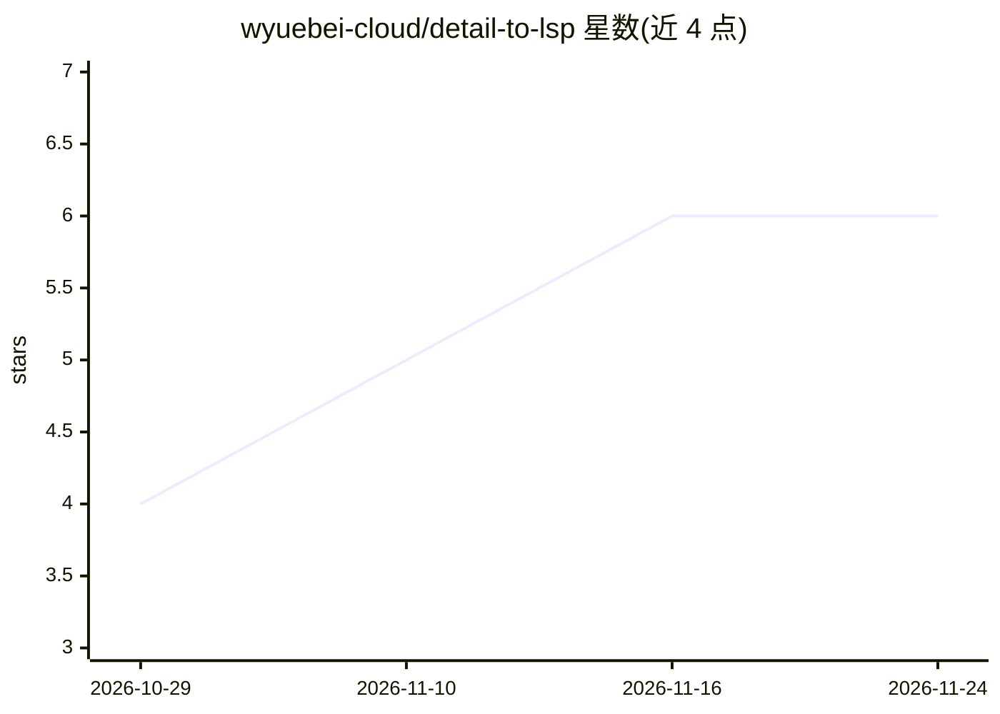

# wyuebei-cloud/detail-to-lsp

⭐ 6 · Python · NOASSERTION · 推送 2026-10-18 · [GitHub](https://github.com/wyuebei-cloud/detail-to-lsp) · 个人维护 · 中文 README

**供 AI 编码 agent 将 CAD 详图重建为 AutoLISP 脚本**

以 SKILL.md 形式定义的操作流程：AI agent 读取 PDF 图纸或截图，提取并测量矢量/栅格信息，生成一份 model.py（带来源标注的坐标记录），再由固定运行时产出单个 AutoLISP 文件。交付前必须通过括号平衡、lint、LISP 子集模拟器逐实体 DXF 校验，并叠加源图做双向覆盖率与尺寸文字检查。依赖 Windows 上的 AutoCAD/Civil 3D 才能最终验证 ActiveX 路径；模拟器不覆盖该部分。MIT 许可，CI 在 ubuntu/windows 双平台回归。

## 筛选速览

| 维度 | 判定 | 备注 |
|---|---|---|
| AI 角色 | `ai-native` | 本体是模型或模型工具 |
| 许可风险 | `none` | NOASSERTION |
| 部署形态 | `library` | 以包/库形式分发 |
| 模型依赖 | — | README 未给出锁定关系 |
| 硬件要求 | — | 无带数字的原话,不猜 |
| 安装摩擦 | `low` | 无编译、无系统依赖或容器化 |
| 成熟度 | — | 结构信号不足 |

## 能力要点

- 生成后经 LISP 模拟器逐实体 DXF 校验，未通过不交付
- model.py 作为唯一坐标来源，每个值带 provenance 标注
- 叠加模拟结果与源图做双向覆盖率检查
- 尺寸文字独立校验防止全局比例错误

## 适用场景

- 把 PDF 图册里的标准详图重建为可运行的 AutoCAD 绘图脚本
- 让 AI agent 自动重建 WSDOT 风格的标准平面图细节
- 对生成的 LISP 文件做模拟器级质量门槛检查

## 场景标签

`代码生成` `文档解析` · 领域:编码与开发

## 证据(README 行号)

> L9: The skill is meant to be executed by an AI coding agent: one Python model per detail,
> L10: a fixed pre-verified LISP runtime, and numeric gates that must pass before anything is
> L29: - An agent with **vision** capability. Phase 0 locates the detail in a rendered page,

## 星数曲线

2026-10-29 4 → 2026-11-24 6（+2）

---
*卡片 v1 · prompt 1.4 · 生成 2026-11-20 · 置信度 mid · 依据 README sha `1feb06d94ffe` · [字段定义](../../DATASET.md)*
