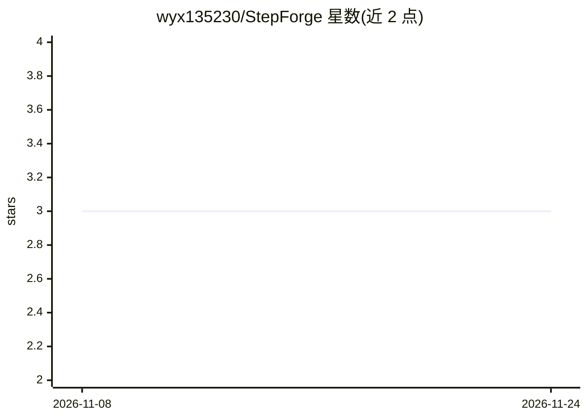

# wyx135230/StepForge

⭐ 3 · C# · MIT · 推送 2026-10-29 · [GitHub](https://github.com/wyx135230/StepForge) · 个人维护 · 中文 README

**Windows 本地流程录制工具，生成可分享的分步操作指南**

面向 Windows 的本地优先工作流文档工具：录制桌面或浏览器操作并保存截图，编辑指令与标注、抹除敏感区域，导出 HTML、PDF、DOCX、MP4、Markdown 等格式，并提供中英文本地旁白生成。面向需要制作软件教程、入职培训、交接文档与 SOP 的用户。AI 指令润色为可选功能，需自行配置 DeepSeek 或兼容端点的 API key 并同意文本/截图分享；核心录制、编辑与导出全程离线可用。应用以完整 zip 包分发，源码构建需 PowerShell 与私有 .NET SDK。

## 筛选速览

| 维度 | 判定 | 备注 |
|---|---|---|
| AI 角色 | `ai-enhanced` | 去掉 AI 部分产品仍成立 |
| 许可风险 | `permissive` | MIT |
| 部署形态 | `desktop` | 安装包/桌面程序 |
| 模型依赖 | — | README 未给出锁定关系 |
| 硬件要求 | — | 无带数字的原话,不猜 |
| 安装摩擦 | `medium` | 含编译或系统依赖之一 |
| 成熟度 | — | 结构信号不足 |

## 能力要点

- 桌面/浏览器操作录制，自动保存截图与本地步骤草稿
- 导出交互式 HTML、MP4、PDF、DOCX、Markdown ZIP 等格式
- 本地生成中英文旁白，包含语音引擎与模型
- 可选 AI 指令生成，支持 DeepSeek 预设与自定义兼容端点

## 适用场景

- 录制软件操作步骤，生成给同事看的分步教程
- 制作新员工入职和培训材料，导出 MP4 或交互 HTML
- 整理标准操作流程（SOP）与岗位交接文档
- 抹除截图中的敏感信息后再分享指南

## 场景标签

`教程课程` · 领域:学习与行业

## 证据(README 行号)

> L9: StepForge is a local-first workflow documentation tool for Windows. Record desktop or browser actions, save steps an
> L78: |AI-generated instructions|Uses your DeepSeek Flash or compatible provider, action facts, and optional screenshots 
> L84: Core features do not require a StepForge account or depend on Scribe services. Team accounts and cloud collaboratio

## 星数曲线

2026-11-08 3 → 2026-11-24 3（+0）

---
*卡片 v1 · prompt 1.4 · 生成 2026-11-21 · 置信度 high · 依据 README sha `e788e82e4e26` · [字段定义](../../DATASET.md)*
