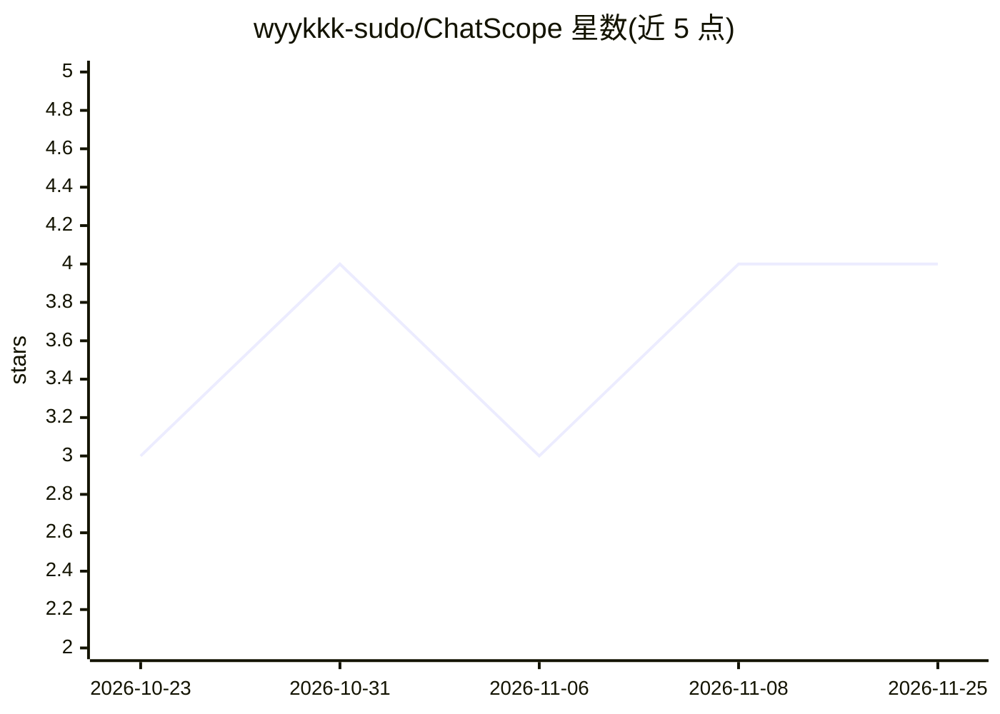

# wyykkk-sudo/ChatScope

⭐ 4 · JavaScript · MIT · 推送 2026-10-21 · [GitHub](https://github.com/wyykkk-sudo/ChatScope) · 个人维护 · 中文 README

**Windows 微信聊天记录分析工具，选会话直接与 AI 问答**

基于 Electron 的 Windows 桌面应用，自动连接本机微信 4.x 数据库，列出好友与群聊，读取所选会话后用内置 ChatLab 引擎生成消息统计与原文搜索，并接入 DeepSeek/OpenAI/Claude/Ollama 等模型对聊天内容问答；回答带可点击原文引用，支持 Markdown 排版、ChatLab JSON 与附件导出。提供安装版与免安装 ZIP，内置运行环境；仅支持 Windows x64 与文字内容分析，原始数据库只读。

## 筛选速览

| 维度 | 判定 | 备注 |
|---|---|---|
| AI 角色 | `ai-native` | 本体是模型或模型工具 |
| 许可风险 | `permissive` | MIT |
| 部署形态 | `desktop` | 安装包/桌面程序 |
| 模型依赖 | local-ok | 支持本地模型 |
| 硬件要求 | — | 无带数字的原话,不猜 |
| 安装摩擦 | `low` | 无编译、无系统依赖或容器化 |
| 成熟度 | `idea` | |

## 能力要点

- 自动发现微信数据目录与好友/群聊，无需手动导出导入
- 内置 ChatLab CLI 作为分析引擎，本地完成统计与检索
- 回答保留可点击原文引用，区分统计、原话与推断
- 支持 ChatLab JSON 导出及 EchoTrace/WeFlow 记录导入

## 适用场景

- 查找聊天中约定的待办、时间节点并核对原文
- 统计群聊活跃度、发言排行与时段分布
- 用本地 Ollama 离线分析微信会话记录

## 场景标签

`数据分析` `聊天机器人` `AI 助手` · 领域:效率与自动化

## 证据(README 行号)

> L11:  自动连接本地微信记录，结合 ChatLab 分析与大模型检索，让重要的约定、讨论和线索更容易找到。
> L51: |**围绕聊天提问**|支持 DeepSeek、OpenAI、Claude、其他兼容接口与本地 Ollama，按需检索当前会话|
> L215: |ChatLab|实际使用官方 CLI **0.37.5** 作为分析引擎，AGPL-3.0；分发时保留原始许可并提供对应源码|

## 星数曲线

2026-10-23 3 → 2026-11-25 4（+1）

---
*卡片 v1 · prompt 1.4 · 生成 2026-11-21 · 置信度 high · 依据 README sha `5d859670de0e` · [字段定义](../../DATASET.md)*
