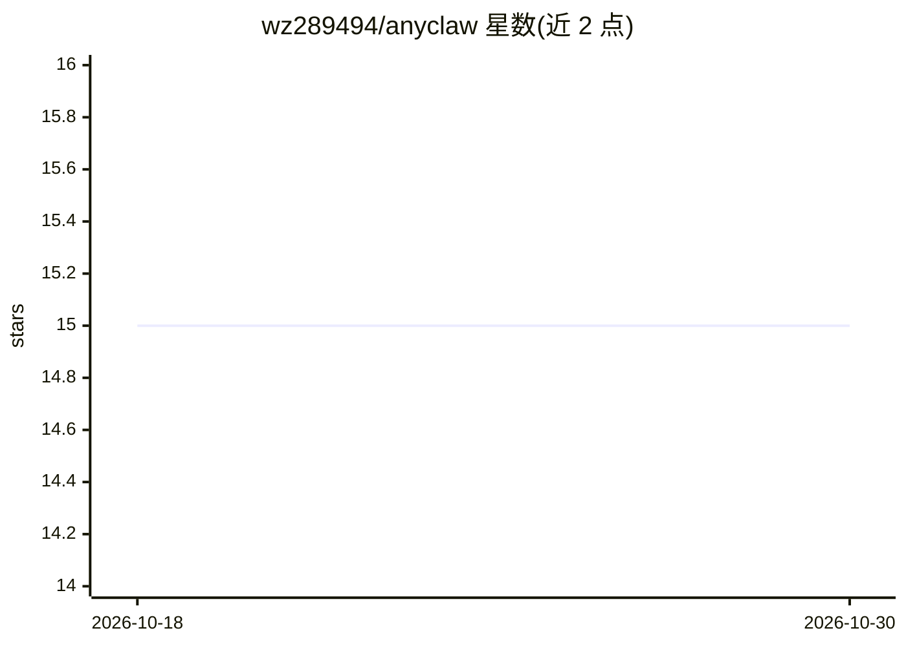

# wz289494/anyclaw

⭐ 15 · Python · GPL-2.0 · 推送 2026-05-15 · [GitHub](https://github.com/wz289494/anyclaw) · 个人维护 · 中文 README

**基于 LangChain 的轻量 ReAct Agent 框架，快速搭建垂类 Agent**

面向开发者的 Python ReAct Agent 底座：基于 LangChain 的推理与工具调用流程，提供 CLI、HTTP API 与浏览器 Copilot 三种使用形态。支持 OpenAI、Gemini、Qwen、DeepSeek、Kimi 等模型接入，通过 config/model.yaml 为不同任务角色分配模型；具备按 task_id 的会话记忆、任务沙盒隔离、NDJSON 流式响应与长上下文压缩。能力扩展分 Tool（框架内注册）与 Skill（SKILL.md 目录）两层，README 给出 vibe coding 改造 SOP。采用非商业学习许可协议。

## 筛选速览

| 维度 | 判定 | 备注 |
|---|---|---|
| AI 角色 | `ai-ecosystem` | LLM/agent 周边工具 |
| 许可风险 | `dual` | GPL-2.0 |
| 部署形态 | `library` | 以包/库形式分发 |
| 模型依赖 | locked-api |  |
| 硬件要求 | — | 无带数字的原话,不猜 |
| 安装摩擦 | `low` | 无编译、无系统依赖或容器化 |
| 成熟度 | — | 结构信号不足 |

## 能力要点

- CLI / HTTP API / 浏览器 Copilot 三种使用形态
- 按 task_id 的会话记忆与任务沙盒隔离，NDJSON 流式响应
- Tool 与 Skill 双层扩展机制（SKILL.md 自动扫描）
- 模型工厂按任务角色（main/文本生成/抽取/代码生成）分配不同模型

## 适用场景

- 为 App、网站或内部系统快速接入垂类 Agent
- 基于现有工具链搭建业务 Agent 并通过 API 服务化
- 用 skills 形式扩展文档、表格、搜索类能力

## 场景标签

`Agent 框架` · 领域:Agent 开发

## 证据(README 行号)

> L5: **轻量化 ReAct Agent 框架，面向垂类 Agent 的快速搭建与接入**
> L14: **AnyClaw** 是一个面向实际落地的轻量化 ReAct Agent 框架。
> L28: - **ReAct Agent 底座**：基于 LangChain 的推理与工具调用流程，适合复杂任务编排

## 星数曲线

2026-10-18 15 → 2026-10-30 15（+0）

---
*卡片 v1 · prompt 1.4 · 生成 2026-10-30 · 置信度 high · 依据 README sha `707bbba0b778` · [字段定义](../../DATASET.md)*
