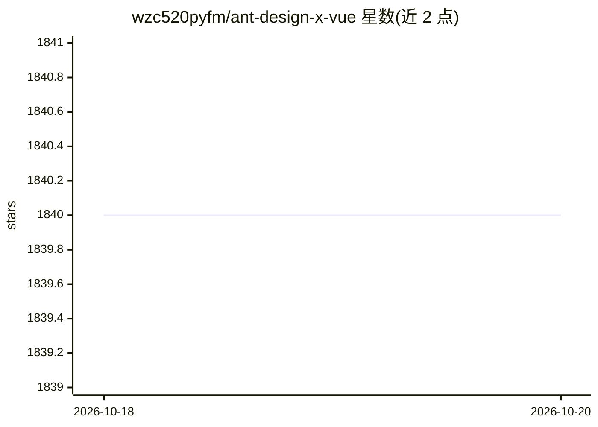

# wzc520pyfm/ant-design-x-vue

⭐ 1,840 · TypeScript · MIT · 推送 2026-10-16 · [GitHub](https://github.com/wzc520pyfm/ant-design-x-vue) · [官网](https://antd-design-x-vue.netlify.app/) · 个人维护 · 中文 README

**Ant Design X 的 Vue 实现：构建 AI 对话界面的组件库**

将 React 版 Ant Design X 组件库移植到 Vue 生态的 UI 组件库，面向需要搭建 AI 对话/LUI 页面的 Vue 开发者。提供 Bubble、XProvider 等组件，覆盖 AI 对话场景组件、数据流管理功能、多种应用模板，可对接符合 OpenAI 标准的模型推理服务。使用 TypeScript 开发并提供完整类型支持，支持细粒度样式调整。通过 npm/yarn/pnpm 安装，需搭配 ant-design-vue 使用，MIT 许可。

## 筛选速览

| 维度 | 判定 | 备注 |
|---|---|---|
| AI 角色 | `ai-ecosystem` | LLM/agent 周边工具 |
| 许可风险 | `permissive` | MIT |
| 部署形态 | `library` | 以包/库形式分发 |
| 模型依赖 | — | README 未给出锁定关系 |
| 硬件要求 | — | 无带数字的原话,不猜 |
| 安装摩擦 | `low` | 无编译、无系统依赖或容器化 |
| 成熟度 | — | 结构信号不足 |

## 能力要点

- AI 对话场景组件（Bubble、XProvider 等）的 Vue 实现
- 数据流管理功能与多种 LUI 应用模板
- 可对接符合 OpenAI 标准的模型推理服务
- TypeScript 开发，提供完整类型支持

## 适用场景

- 在 Vue 项目中搭建 AI 聊天/对话界面
- 对接 OpenAI 标准模型服务并快速启动 LUI 应用开发
- 复用模板快速构建个性化 AI 交互页面

## 场景标签

 · 领域:前端/AI 界面组件

## 证据(README 行号)

> L19: 这里是 Ant Design X 的 Vue 实现。
> L25: - ⚡ 轻松对接符合 OpenAI 标准的模型推理服务

## 星数曲线

2026-10-18 1,840 → 2026-10-20 1,840（+0）

---
*卡片 v1 · prompt 1.4 · 生成 2026-10-18 · 置信度 high · 依据 README sha `562dc1067322` · [字段定义](../../DATASET.md)*
