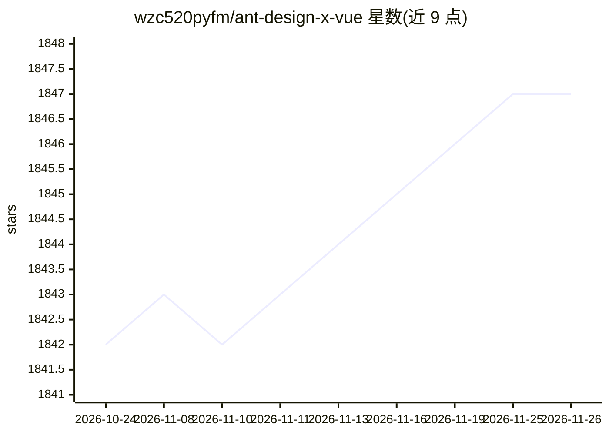

# wzc520pyfm/ant-design-x-vue

⭐ 1,847 · TypeScript · MIT · 推送 2026-11-25 · [GitHub](https://github.com/wzc520pyfm/ant-design-x-vue) · [官网](https://ant-design-x-vue.netlify.app/) · 个人维护 · 中文 README

**Ant Design X 的 Vue 实现：AI 对话界面组件库**

将 Ant Design X（原 React 版）移植到 Vue 的 UI 组件库，基于 RICH 交互范式提供对话类组件（如 Bubble、XProvider），覆盖 AI 对话场景，附数据流管理功能与多种应用模板。采用 TypeScript 开发并支持细粒度样式定制，可对接符合 OpenAI 标准的模型推理服务。通过 npm/yarn/pnpm 安装，面向使用 Vue 构建聊天界面的前端开发者。

## 筛选速览

| 维度 | 判定 | 备注 |
|---|---|---|
| AI 角色 | `ai-ecosystem` | LLM/agent 周边工具 |
| 许可风险 | `permissive` | MIT |
| 部署形态 | `library` | 以包/库形式分发 |
| 模型依赖 | — | README 未给出锁定关系 |
| 硬件要求 | — | 无带数字的原话,不猜 |
| 安装摩擦 | `low` | 无编译、无系统依赖或容器化 |
| 成熟度 | — | 结构信号不足 |

## 能力要点

- 基于 RICH 交互范式的 AI 对话组件（Bubble、XProvider 等）
- 提供数据流管理与多种 LUI 应用模板
- TypeScript 开发，完整类型支持
- 对接符合 OpenAI 标准的模型推理服务

## 适用场景

- 为 Vue 项目快速搭建 AI 聊天/对话界面
- 构建个性化 AI 交互页面（LUI 应用）
- 接入 OpenAI 标准兼容的推理服务做前端展示

## 场景标签

`聊天机器人` · 领域:对话与助手

## 证据(README 行号)

> L19: 这里是 Ant Design X 的 Vue 实现。
> L25: - ⚡ 轻松对接符合 OpenAI 标准的模型推理服务

## 星数曲线

2026-10-24 1,842 → 2026-11-26 1,847（+5）

---
*卡片 v1 · prompt 1.4 · 生成 2026-11-23 · 置信度 high · 依据 README sha `a8f150cfd895` · [字段定义](../../DATASET.md)*
