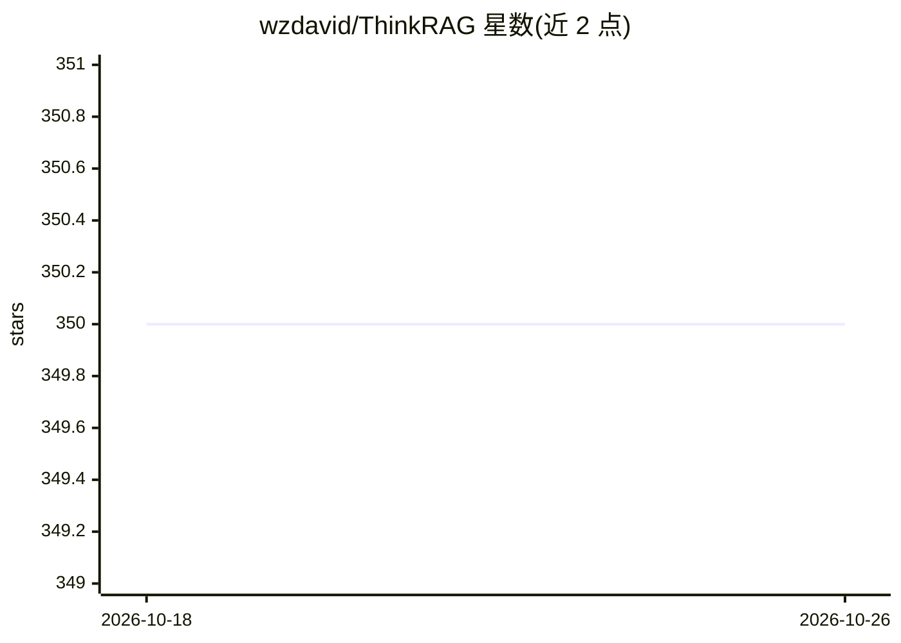

# wzdavid/ThinkRAG

⭐ 350 · Python · MIT · 推送 2026-01-28 · [GitHub](https://github.com/wzdavid/ThinkRAG) · 个人维护 · 中文 README

**可部署在笔记本上的本地知识库 RAG 问答系统**

基于 LlamaIndex 与 Streamlit 构建的 RAG 应用，面向专业人员、研究者、学生等知识工作者，在笔记本电脑本地完成知识库问答，数据全部存于本机，无需 GPU。支持 OpenAI API 及兼容接口（DeepSeek、Moonshot、ZhiPu 等），本地部署选用 Ollama（因兼容性问题需装 0.3.3），embedding 与 rerank 选用 BAAI BGE 系列。开发模式用本地文件存储免装数据库，生产模式改用 LanceDB/Chroma 与 Redis；针对中文做了 Spacy 分割、中文提示模板等优化。存在未解决的 Windows 已知问题，建议在 Linux/macOS 使用。

## 筛选速览

| 维度 | 判定 | 备注 |
|---|---|---|
| AI 角色 | `ai-native` | 本体是模型或模型工具 |
| 许可风险 | `permissive` | MIT |
| 部署形态 | `library` | 以包/库形式分发 |
| 模型依赖 | local-ok | 支持本地模型 |
| 硬件要求 | — | 无带数字的原话,不猜 |
| 安装摩擦 | `low` | 无编译、无系统依赖或容器化 |
| 成熟度 | — | 结构信号不足 |

## 能力要点

- 本地知识库 RAG 问答，无需 GPU，数据全存本机
- 支持 OpenAI 兼容 API（DeepSeek/Moonshot/ZhiPu）与 Ollama 本地模型
- 开发模式本地文件存储免装数据库，生产模式用 LanceDB/Chroma+Redis
- 面向中文优化：Spacy 分割、中文标题增强、中文提示模板、bge 双语 embedding

## 适用场景

- 在笔记本上搭建个人本地知识库问答系统
- 上传 PDF/DOCX/PPTX 或网页 URL 建立知识库并提问
- 离线环境下用 Ollama 本地模型做检索增强问答

## 场景标签

`RAG` `文档问答` · 领域:知识与检索

## 证据(README 行号)

> L10: ThinkRAG is a LLM RAG system that can be easily deployed on a laptop to implement Q&A with local knowledge base.
> L18: ThinkRAG is a LLM application developed for professionals, researchers, students, and other knowledge workers, whic

## 星数曲线

2026-10-18 350 → 2026-10-26 350（+0）

---
*卡片 v1 · prompt 1.4 · 生成 2026-10-21 · 置信度 high · 依据 README sha `3b3552eb6d7a` · [字段定义](../../DATASET.md)*
