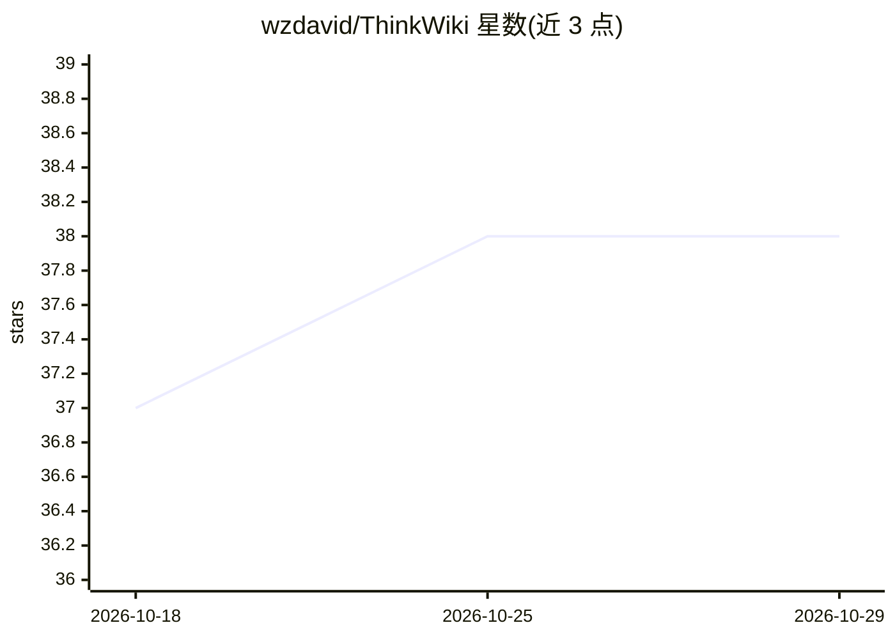

# wzdavid/ThinkWiki

⭐ 38 · Python · MIT · 推送 2026-07-13 · [GitHub](https://github.com/wzdavid/ThinkWiki) · 个人维护 · 中文 README

**面向 agent 的本地知识库技能：把文档笔记变成 Markdown wiki**

遵循开放 Agent Skills 格式（SKILL.md + 脚本）的本地知识库技能，安装到 Claude Code、OpenClaw、Cursor 等 skills 兼容 agent 后，通过对话完成 wiki 初始化、网页/文件剪藏到 inbox、审阅后正式入库、证据优先的问答，并生成内容知识图与可浏览的 HTML 工作区（inbox/查看器/图浏览/治理报告）。支持导入 Markdown、PDF、DOCX、XLSX、PPTX 等。远程 AI 功能默认关闭，未配置 LLM 时 crystallize/digest 走本地启发式；本地环境需 Python 3，首次使用自动 bootstrap。

## 筛选速览

| 维度 | 判定 | 备注 |
|---|---|---|
| AI 角色 | `ai-enhanced` | 去掉 AI 部分产品仍成立 |
| 许可风险 | `permissive` | MIT |
| 部署形态 | `None` |  |
| 模型依赖 | — | README 未给出锁定关系 |
| 硬件要求 | — | 无带数字的原话,不猜 |
| 安装摩擦 | `low` | 无编译、无系统依赖或容器化 |
| 成熟度 | — | 结构信号不足 |

## 能力要点

- SKILL.md 格式 agent 技能，通过对话完成剪藏、入库、问答与知识图构建
- 生成可本地浏览的 HTML 工作区：inbox 审阅、页面查看器、交互式内容知识图与治理报告
- 支持导入 Markdown/PDF/DOCX/XLSX/XLS/PPTX/网页/纯文本
- 远程 LLM 与 embedding 默认关闭，可用任意 OpenAI 兼容端点或本地 Ollama；未配置时走本地启发式

## 适用场景

- 让 Claude Code 等 agent 帮我搭建并维护个人本地知识库
- 把网页、PDF、笔记剪藏到 inbox，审阅后沉淀为结构化 wiki 页面
- 基于已有 wiki 页面做证据优先的问答与知识图探索

## 场景标签

`知识库管理` `知识图谱` `文档问答` · 领域:知识与检索

## 证据(README 行号)

> L7: ThinkWiki is an **agent-native local knowledge base skill**. Talk to your agent to turn scattered documents, web pag
> L15: ThinkWiki follows the open Agent Skills format (`SKILL.md` + bundled scripts). If your agent can install skills and
> L185: Without a complete LLM configuration, `crystallize` and `digest` use local heuristics only.

## 星数曲线

2026-10-18 37 → 2026-10-29 38（+1）

---
*卡片 v1 · prompt 1.4 · 生成 2026-10-25 · 置信度 high · 依据 README sha `b0a6082cf9be` · [字段定义](../../DATASET.md)*
