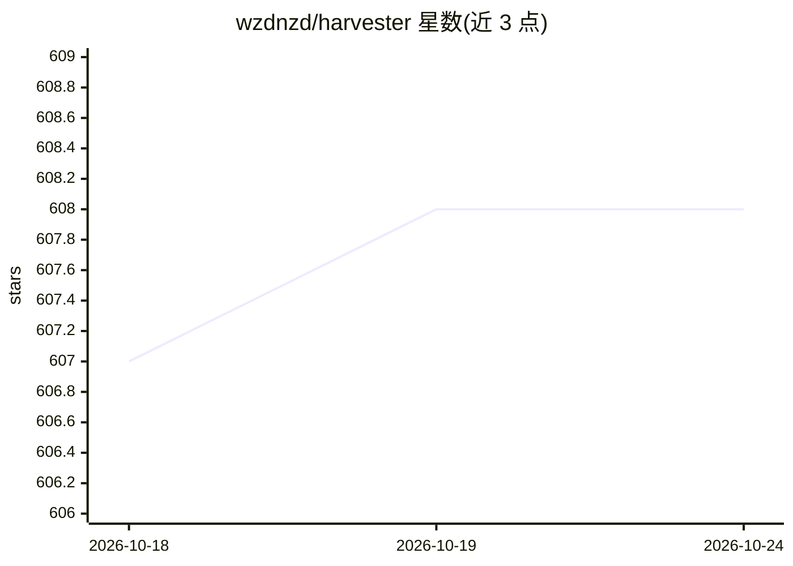

# wzdnzd/harvester

⭐ 608 · Python · NOASSERTION · 推送 2026-06-23 · [GitHub](https://github.com/wzdnzd/harvester) · [官网](https://github.com/wzdnzd/harvester) · 个人维护 · 中文 README

**通用数据采集框架：从 GitHub 等多源发现并验证 AI 服务密钥**

分层架构的数据采集框架，定位为可扩展的多源信息获取系统：当前实现聚焦于从 GitHub 代码搜索中发现 AI 服务商 API 密钥，通过四阶段流水线（搜索→采集→校验→检查）执行，包括密钥有效性验证、模型枚举与配额分析，覆盖 OpenAI 兼容接口、Anthropic、Azure OpenAI、Gemini、Bedrock、百度文心、智谱等。另规划 FOFA/Shodan/自定义 API 等数据源。以 Python 源码方式提供，需配置 GitHub token 后运行。

## 筛选速览

| 维度 | 判定 | 备注 |
|---|---|---|
| AI 角色 | `ai-ecosystem` | LLM/agent 周边工具 |
| 许可风险 | `none` | NOASSERTION |
| 部署形态 | `library` | 以包/库形式分发 |
| 模型依赖 | locked-api |  |
| 硬件要求 | — | 无带数字的原话,不猜 |
| 安装摩擦 | `low` | 无编译、无系统依赖或容器化 |
| 成熟度 | — | 结构信号不足 |

## 能力要点

- 四阶段流水线：搜索/采集/校验/检查，支持 DAG 执行与插件扩展
- 密钥校验与能力探测：模型枚举、服务限额与配额分析
- 数学化的查询优化引擎：正则解析、可分裂性分析与枚举优化
- 限流、凭证轮换、状态持久化与任务恢复机制

## 适用场景

- 从 GitHub 代码中批量搜索并验证 AI 服务 API 密钥
- 对已验证密钥进行模型枚举与配额能力探测
- 基于插件架构扩展自定义数据源的采集任务

## 场景标签

 · 领域:数据采集/自动化工具

## 证据(README 行号)

> L5: A universal, adaptive data acquisition framework designed for comprehensive information acquisition from multiple so
> L185: ### 🔍 Current Implementation (AI Service Discovery)

## 星数曲线

2026-10-18 607 → 2026-10-24 608（+1）

---
*卡片 v1 · prompt 1.4 · 生成 2026-10-21 · 置信度 mid · 依据 README sha `a96c94d91338` · [字段定义](../../DATASET.md)*
