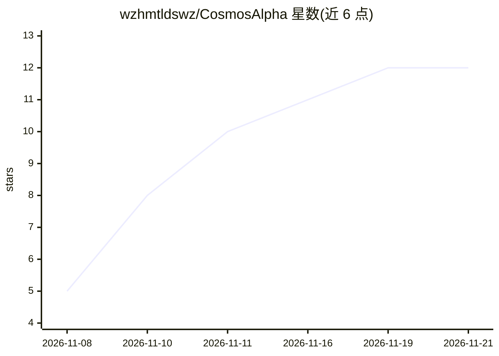

# wzhmtldswz/CosmosAlpha

⭐ 12 · Python · MIT · 推送 2026-11-05 · [GitHub](https://github.com/wzhmtldswz/CosmosAlpha) · [官网](https://arxiv.org/abs/2611.04555) · 个人维护 · 中文 README

**面向量化研究者，用 LLM 挖掘 Alpha 因子的框架**

CosmosAlpha 将因子池组织为多关系图（生成谱系、表达式结构相似性、截面暴露相关性），提供 Graph Flow、Chain、MCTS、Parallel Branches 四种搜索架构，用帕累托引导的选择机制平衡质量、繁殖力与多样性；挖掘出的因子与 LightGBM 集成做预测与组合评估。LLM 通过 OpenAI 兼容接口配置，需自备 API key 与从 Zenodo 下载的数据；结果存于 runs 目录，Graph/Chain/Parallel 分支支持 --resume 续跑，MCTS 需新 run ID。

## 筛选速览

| 维度 | 判定 | 备注 |
|---|---|---|
| AI 角色 | `ai-native` | 本体是模型或模型工具 |
| 许可风险 | `permissive` | MIT |
| 部署形态 | `desktop` | 安装包/桌面程序 |
| 模型依赖 | — | README 未给出锁定关系 |
| 硬件要求 | — | 无带数字的原话,不猜 |
| 安装摩擦 | `low` | 无编译、无系统依赖或容器化 |
| 成熟度 | — | 结构信号不足 |

## 能力要点

- 四种挖掘架构：Graph、Chain、Parallel Branches、单树 MCTS
- 因子池组织为多关系图并以帕累托引导选择
- LightGBM 集成因子做预测与日频组合评估
- 支持 --smoke-loop 离线安装自检与 --preflight-only 预检

## 适用场景

- 在 CSI300 数据上批量挖掘并筛选 Alpha 因子
- 用 LightGBM 集成已挖掘因子做回测与组合评估
- 通过 MCTS 或图搜索自动化探索因子空间

## 场景标签

`金融量化` `科研工具` · 领域:学习与行业

## 证据(README 行号)

> L7: **CosmosAlpha** is an LLM-driven alpha-mining framework that organizes the factor
> L12: integrated with LightGBM for predictive and portfolio evaluation.

## 星数曲线

2026-11-08 5 → 2026-11-21 12（+7）

---
*卡片 v1 · prompt 1.4 · 生成 2026-11-18 · 置信度 mid · 依据 README sha `1089f3680f4c` · [字段定义](../../DATASET.md)*
