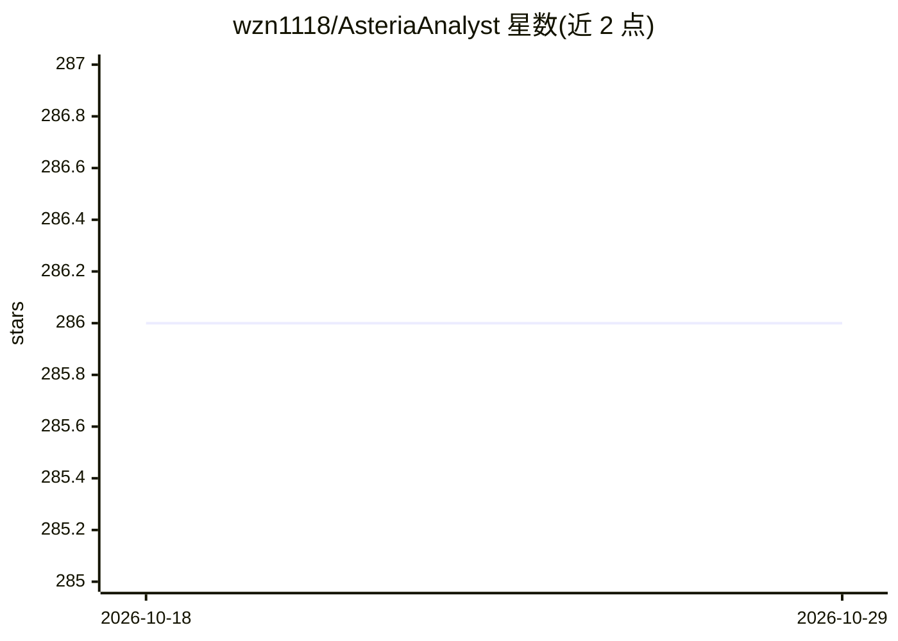

# wzn1118/AsteriaAnalyst

⭐ 286 · Python · 推送 2026-07-28 · [GitHub](https://github.com/wzn1118/AsteriaAnalyst) · 个人维护 · 中文 README

**面向企业的本地数据分析与统计实验、管理报告工作台**

本地运行的 Windows 数据分析工作台：接入 CSV/XLSX 等本机数据，通过 Analysis Lab 从 362 条注册统计方法（81 条可运行）中选择方法执行统计、机器学习与可视化；正式管理报告走内置强制处理链，数值由确定性执行器计算，AI 输出需留下追溯工件并通过结构校验，质量不达标不进入发布流程。另含数据质量核验、报告修订与版本发布、Skill/Report Agent Team/Codex Runtime 扩展层。前端 Next.js 16，后端 FastAPI，当前从源码启动（Python 3.11 + Node.js 20+），Windows 便携版开发中。

## 筛选速览

| 维度 | 判定 | 备注 |
|---|---|---|
| AI 角色 | `ai-enhanced` | 去掉 AI 部分产品仍成立 |
| 许可风险 | `none` | — |
| 部署形态 | `None` |  |
| 模型依赖 | — | README 未给出锁定关系 |
| 硬件要求 | — | 无带数字的原话,不猜 |
| 安装摩擦 | `low` | 无编译、无系统依赖或容器化 |
| 成熟度 | `idea` | |

## 能力要点

- 362 条注册统计方法（81 条可运行），展开为 4,028 张 Lab 方法卡
- 正式报告强制处理链：确定性数值计算 + AI 输出追溯工件与结构校验
- 数据质量识别：字段类型、缺失值、异常值、重复项与时间连续性
- 报告修订工作区：批注、附件、差异与本地版本发布

## 适用场景

- 把销售、库存、成本等业务表格转化为可审阅的管理报告
- 统计实验与方法比较，保留字段角色、参数与运行记录
- 对既有报告做批注审阅与版本管理
- 沉淀数据字典与质量证据做口径治理

## 场景标签

`数据分析` · 领域:效率与自动化

## 证据(README 行号)

> L8: > 面向经营分析、统计建模、数据质量核验与正式管理报告交付的本地工作台。Asteria Analyst 将数据接入、字段语义理解、分析方案、确定性计算、证据校验、报告生成、协作修订和版本发布连成一条可追溯的数据分析流程。
> L64: - **经营与管理分析**：将销售、客户、渠道、库存、成本、预算或运营表格转化为可审阅的指标、图表、解释和管理报告材料。
> L102: 这条链路分别承担数据画像、字段语义映射、业务场景路由、指标派生规划、确定性数值计算、证据验证、报告绑定与发布门控。AI 输出需要留下追溯工件并通过结构校验；数值由确定性执行器计算；缺少必要追溯信息或质量未达到发布要求时，正式报告

## 星数曲线

2026-10-18 286 → 2026-10-29 286（+0）

---
*卡片 v1 · prompt 1.4 · 生成 2026-10-22 · 置信度 high · 依据 README sha `5ee3cf3a54fb` · [字段定义](../../DATASET.md)*
