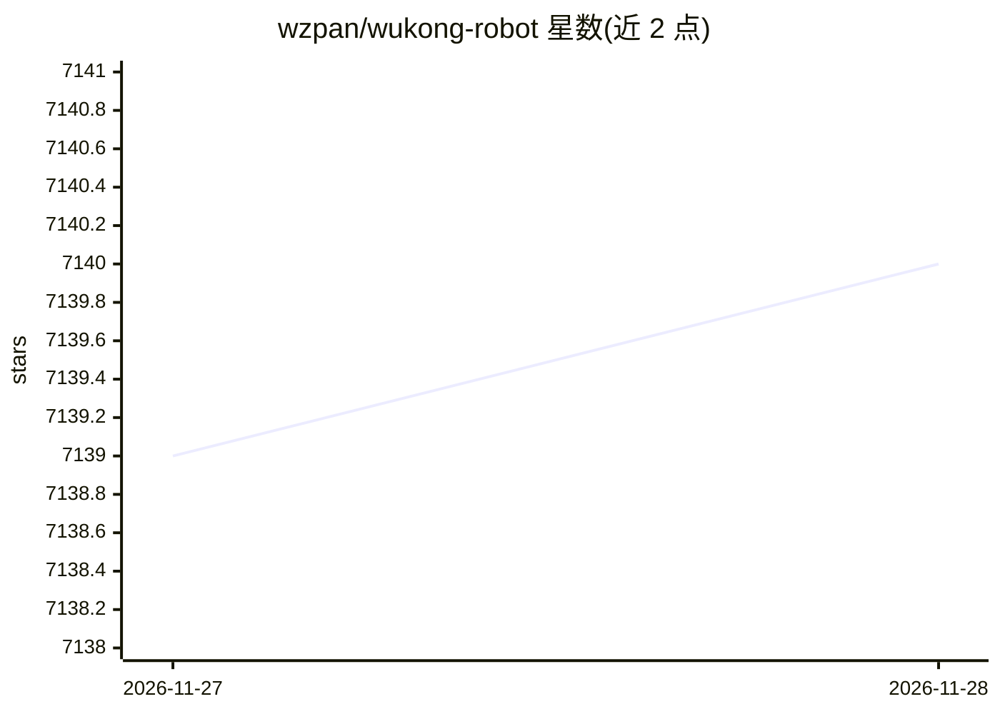

# wzpan/wukong-robot

⭐ 7,140 · Python · MIT · 推送 2026-11-25 · [GitHub](https://github.com/wzpan/wukong-robot) · [官网](https://wukong.hahack.com/) · 个人维护 · 中文 README

**面向 Maker 的中文语音对话机器人/智能音箱项目**

wukong-robot 是一个中文语音对话机器人/智能音箱项目，面向想自建个性化智能音箱的 Maker。工作流程为：离线唤醒后经 ASR 识别文本、NLU 解析、技能匹配交由插件处理，结果经 TTS 合成语音播放。ASR/TTS/对话机器人均模块化，支持百度、讯飞、Whisper、VITS 声音克隆等方案，对话支持 AnyQ 本地机器人及图灵、ChatGPT 在线接入；支持 Porcupine/snowboy 离线唤醒与 Muse 脑机唤醒，可联动 HomeAssistant 等智能家居，并带 Web 后台管理端与开放 API。需 Python ≥3.7 且 <3.10。

## 筛选速览

| 维度 | 判定 | 备注 |
|---|---|---|
| AI 角色 | `ai-native` | 本体是模型或模型工具 |
| 许可风险 | `permissive` | MIT |
| 部署形态 | `library` | 以包/库形式分发 |
| 模型依赖 | — | README 未给出锁定关系 |
| 硬件要求 | — | 无带数字的原话,不猜 |
| 安装摩擦 | `low` | 无编译、无系统依赖或容器化 |
| 成熟度 | `idea` | |

## 能力要点

- ASR→NLU→技能插件→TTS 的模块化语音交互流水线
- 集成百度/讯飞/阿里/腾讯/Whisper/VITS 等多家中文语音方案
- Porcupine/snowboy 离线唤醒，并支持 Muse 脑机唤醒
- Web 后台管理端与开放 RESTful API

## 适用场景

- 在树莓派等设备上自建中文语音智能音箱
- 通过语音控制 HomeAssistant 等智能家居设备
- 接入 ChatGPT 实现多轮语音对话
- 编写自定义技能插件扩展音箱功能

## 场景标签

`语音 Agent` `聊天机器人` · 领域:对话与助手

## 证据(README 行号)

> L7:  wukong-robot 是一个简单、灵活、优雅的中文语音对话机器人/智能音箱项目，目的是让中国的 Maker 和 Haker 们也能快速打造个性化的智能音箱。wukong-robot 还可能是第一个开源的脑机唤醒智能音箱。
> L39: wukong-robot 被唤醒后，用户的语音指令先经过 ASR 引擎进行 ASR 识别成文本，然后对识别到的文本进行 NLU 解析，再将解析结果进行技能匹配，交给适合处理该指令的技能插件去处理。插件处理完成后，得到的结果再交给 

## 星数曲线

2026-11-27 7,139 → 2026-11-28 7,140（+1）

---
*卡片 v1 · prompt 1.4 · 生成 2026-11-27 · 置信度 high · 依据 README sha `811c174d9473` · [字段定义](../../DATASET.md)*
