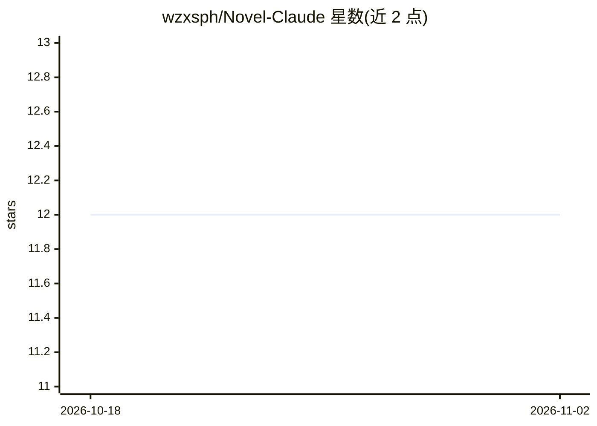

# wzxsph/Novel-Claude

⭐ 12 · Python · GPL-3.0 · 推送 2026-08-09 · [GitHub](https://github.com/wzxsph/Novel-Claude) · 个人维护 · 中文 README

**长篇网文生成框架：CLI/REPL 组织从世界观到章节写作的 LLM 流程**

实验性的长篇小说生成框架（作者自述为新手学习作品，非生产级软件）：把世界构建、分卷规划、章节写作、审核与实体跟踪组织成 CLI 与交互式 REPL 流程，通过 OpenAI 兼容接口调用聊天模型（示例配置为 MiniMax，智谱用于 Batch 与 RAG 嵌入）。基于微内核与插件架构，Skill 经事件总线注入上下文或工具，支持热重载与 AI 生成 Skill（会写入 Python 代码，需人工审查）。使用 ChromaDB 做 RAG 记忆，无 GUI，需 Python 3.10+ 与 uv，多数字生成为实验性状态。

## 筛选速览

| 维度 | 判定 | 备注 |
|---|---|---|
| AI 角色 | `ai-native` | 本体是模型或模型工具 |
| 许可风险 | `viral` | GPL-3.0 |
| 部署形态 | `library` | 以包/库形式分发 |
| 模型依赖 | — | README 未给出锁定关系 |
| 硬件要求 | — | 无带数字的原话,不猜 |
| 安装摩擦 | `low` | 无编译、无系统依赖或容器化 |
| 成熟度 | `idea` | |

## 能力要点

- CLI 与交互式 REPL 两种入口，覆盖 init/plan/write/review/audit/track 全流程命令
- Skill 插件架构：事件总线注入、热重载、AI 自动生成 Skill（高风险，需人工审查）
- ChromaDB RAG 记忆与智谱 Batch API 支持
- 兼容 OpenAI Chat Completions 的模型服务，密钥经 env 文件配置

## 适用场景

- 用一句话创意生成世界观、大纲与分卷章节的网文创作流程
- 通过插件扩展写作工具或上下文注入
- 用 Batch API 批量生成章节内容

## 场景标签

`AI 写作` · 领域:内容生成

## 证据(README 行号)

> L14: Novel-Claude 是一个实验性的长篇小说生成框架。它将世界构建、分卷规划、章节写作和记忆检索组织成一条 CLI 流程，并允许 Skill 通过事件总线注入上下文或工具。
> L23: |世界构建、分卷规划、章节写作|实验性|需要兼容 OpenAI Chat Completions 的模型服务|
> L10: > **这是一个新手练手与学习实验作品，不是生产级软件。**

## 星数曲线

2026-10-18 12 → 2026-11-02 12（+0）

---
*卡片 v1 · prompt 1.4 · 生成 2026-10-31 · 置信度 mid · 依据 README sha `9930a35555d5` · [字段定义](../../DATASET.md)*
