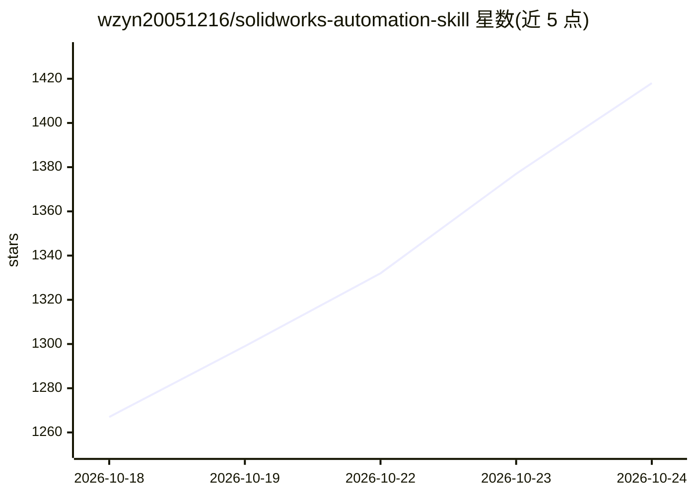

# wzyn20051216/solidworks-automation-skill

⭐ 1,418 · Python · MIT · 推送 2026-10-23 · [GitHub](https://github.com/wzyn20051216/solidworks-automation-skill) · 个人维护 · 中文 README

**让 AI Agent 用自然语言驱动 SolidWorks/AutoCAD 的 Skill+MCP 工具集**

面向 Codex、Claude、Cursor 等 Agent 的桌面 CAD 自动化工具集，通过 Skill、MCP、CAD Studio 桌面版三种平级入口调用真实 CAD 软件（COM 与后端）。Execution Core 统一执行状态、结果验证、失败恢复与结构化 Trace，能力缺口返回 CAPABILITY_GAP 交还 Agent 查证。能力按 verified/stable/pilot/blocked 四级登记于 capabilities.yaml，原生 SLDPRT 需合法 SolidWorks 环境（以 2026 为验收目标），无 SolidWorks 时经 OCCT 完成开放格式任务。附 37 个确定性可靠性场景测试。

## 筛选速览

| 维度 | 判定 | 备注 |
|---|---|---|
| AI 角色 | `ai-ecosystem` | LLM/agent 周边工具 |
| 许可风险 | `permissive` | MIT |
| 部署形态 | `library` | 以包/库形式分发 |
| 模型依赖 | — | README 未给出锁定关系 |
| 硬件要求 | — | 无带数字的原话,不猜 |
| 安装摩擦 | `low` | 无编译、无系统依赖或容器化 |
| 成熟度 | — | 结构信号不足 |

## 能力要点

- Skill / MCP / CAD Studio 三种平级入口共用 capabilities.yaml 能力清单
- Verification-first：工具成功不等于任务成功，交付前做结果验证
- 能力缺口结构化返回 CAPABILITY_GAP，交还 Agent 查证后最小实现
- 覆盖建模、装配、GB/T 工程图、导出、Motion、FEA 编排等能力，分四级状态登记

## 适用场景

- 通过自然语言让 Agent 在 SolidWorks 中建模并生成工程图
- Agent 自动 Tool Calling 调用 CAD 完成 CNC 安装座、齿轮等设计
- 无 SolidWorks 环境时用 OCCT 写入 STEP/STL 等开放格式

## 场景标签

 · 领域:CAD/工程自动化

## 证据(README 行号)

> L3: **AI Skill + MCP toolkit for reliable desktop CAD automation.**
> L19: User → Agent (Codex / Claude / Cursor) → Skill / MCP → Execution Core → CAD → Artifacts + Evidence
> L64: |**MCP**|Codex / Claude / Cursor / Windsurf 等 MCP 客户端|否|Agent 自动 Tool Calling|

## 星数曲线

2026-10-18 1,267 → 2026-10-24 1,418（+151）

---
*卡片 v1 · prompt 1.4 · 生成 2026-10-21 · 置信度 high · 依据 README sha `2ec5fc6e35f2` · [字段定义](../../DATASET.md)*
