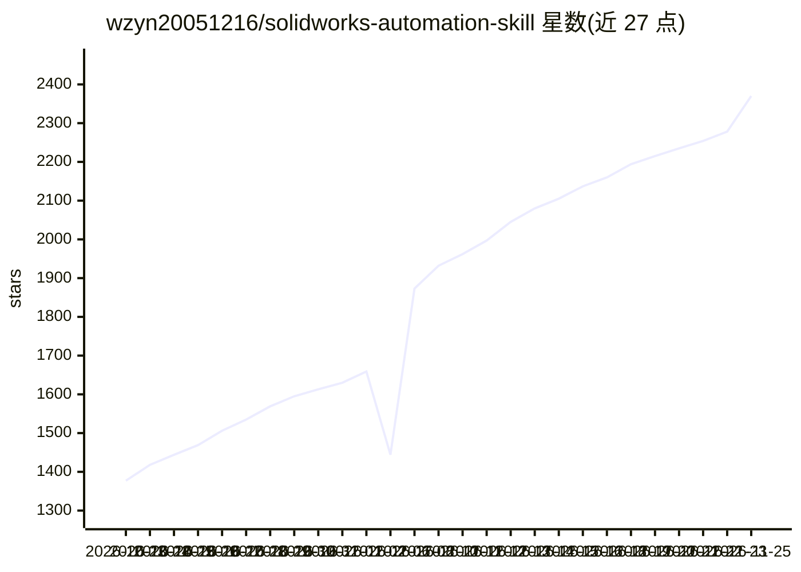

# wzyn20051216/solidworks-automation-skill

⭐ 2,370 · Python · MIT · 推送 2026-11-22 · [GitHub](https://github.com/wzyn20051216/solidworks-automation-skill) · 个人维护 · 中文 README

**让 AI Agent 通过 Skill/MCP 驱动 SolidWorks/AutoCAD 的自动化工具包**

面向 Windows 桌面的 CAD 自动化工具包：通过 Skill、MCP、CAD Studio 桌面版三个平级入口，让 Codex、Claude、Cursor 等 Agent 以自然语言驱动本机 SolidWorks（COM 接口）与可选 AutoCAD，覆盖建模、装配、GB/T 工程图、导出、运动算例、FEA 编排等能力，并按 capabilities.yaml 登记 verified/stable/pilot/blocked 状态。核心机制是验证优先交付与执行追踪：工具调用成功不视为任务完成，附 43 个确定性可靠性场景与结构化证据。原生格式依赖本机已许可的 SolidWorks；无 SolidWorks 时仅可经 OCCT 写入开放格式。

## 筛选速览

| 维度 | 判定 | 备注 |
|---|---|---|
| AI 角色 | `ai-ecosystem` | LLM/agent 周边工具 |
| 许可风险 | `permissive` | MIT |
| 部署形态 | `library` | 以包/库形式分发 |
| 模型依赖 | — | README 未给出锁定关系 |
| 硬件要求 | — | 无带数字的原话,不猜 |
| 安装摩擦 | `low` | 无编译、无系统依赖或容器化 |
| 成熟度 | — | 结构信号不足 |

## 能力要点

- Skill / MCP / CAD Studio 三个平级入口，共用同一能力清单与证据系统
- 验证优先交付：工具成功≠任务成功，附 43 个确定性可靠性场景与结构化 Trace
- 完整模式暴露 69 个命名工具，默认发现模式仅暴露 3 个检索入口
- 无 SolidWorks 时经 OCCT 隔离进程写入 STEP/STL/OBJ/GLB 等开放格式

## 适用场景

- 用自然语言让 Agent 自动生成 SolidWorks 零件、装配与 GB/T 工程图
- DWG/DXF 二维绘图与导出 STEP/STL/PDF 等多种格式
- 把 Agent 驱动的 CAD 任务结果做验证与追踪后再交付
- 没有 SolidWorks 的机器上进行 OCCT 开放格式建模

## 场景标签

`GUI 自动化` · 领域:效率与自动化

## 证据(README 行号)

> L5: 让 Codex、Claude、Cursor 等 Agent 通过自然语言调用真实 CAD 软件，并对执行结果进行验证与追踪。
> L23: User → Agent (Codex / Claude / Cursor) → Skill / MCP → Execution Core → CAD → Artifacts + Evidence
> L129: |**Skill**|支持 skill 导入的 Agent 客户端|否|自然语言驱动 SolidWorks|

## 星数曲线

2026-10-23 1,377 → 2026-11-25 2,370（+993）

---
*卡片 v1 · prompt 1.4 · 生成 2026-11-23 · 置信度 high · 依据 README sha `a8224a85aaeb` · [字段定义](../../DATASET.md)*
