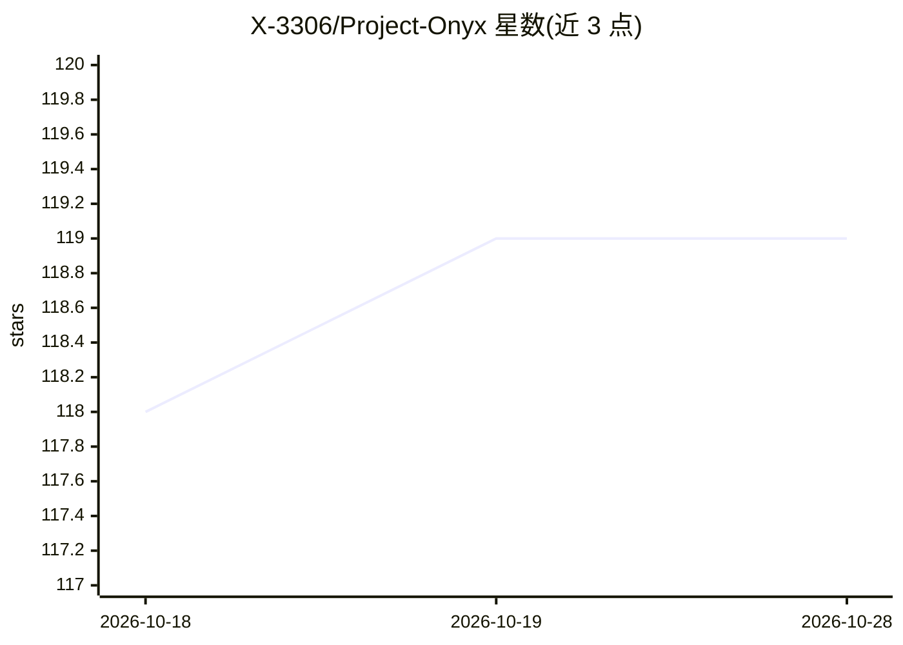

# X-3306/Project-Onyx

⭐ 119 · C · GPL-3.0 · 推送 2026-09-17 · [GitHub](https://github.com/X-3306/Project-Onyx) · 个人维护

**红队研究 PoC：以 ONNX 模型为载体的 EDR 行为伪装执行链**

面向安全研究的概念验证红队管线，演示针对 EDR 的多层规避技术：以 SqueezeNet ONNX 模型做 AI 遥测伪装（用 onnxruntime 跑真实推理）、由 MachineGuid/卷序列号/SID 派生的环境密钥、AES 密钥藏于 ONNX float32 权重 LSB 的隐写、经 wasm3 内存内执行的 WASM 沙箱载荷，以及借模型更新下行的 Dead-Drop C2。作者自述并非可用的生产级绕过，运行载荷限定为心跳信标；需在 Windows 上从源码编译（VS2022/CMake/Python/Rust，并自行构建 ONNX Runtime 静态库）。

## 筛选速览

| 维度 | 判定 | 备注 |
|---|---|---|
| AI 角色 | `ai-enhanced` | 去掉 AI 部分产品仍成立 |
| 许可风险 | `viral` | GPL-3.0 |
| 部署形态 | `desktop` | 安装包/桌面程序 |
| 模型依赖 | — | README 未给出锁定关系 |
| 硬件要求 | — | 无带数字的原话,不猜 |
| 安装摩擦 | `medium` | 含编译或系统依赖之一 |
| 成熟度 | `idea` | |

## 能力要点

- 嵌入真实 SqueezeNet ONNX 模型并以 onnxruntime 执行推理作行为伪装
- AES-256 密钥材料隐写于 ONNX float32 权重 LSB 的 weight vault
- 硬件绑定环境密钥（MachineGuid/卷序列号/用户 SID 的 SHA-256）
- 载荷编译为 WASM 由 wasm3 内存内解释执行，运行时限心跳信标与两种安全指令

## 适用场景

- 在授权实验环境中研究 EDR 行为级规避与检测思路
- 研究模型权重隐写与借模型更新传递控制信号的通道可行性
- 作为红队多层执行链架构的教学起点

## 场景标签

`网络安全` · 领域:学习与行业

## 证据(README 行号)

> L16: 1. **AI Decoy (Behavioral Camouflage):** Now, Project Onyx embeds a legitimate SqueezeNet 1.0 ONNX image-classifica
> L19: 4. **ONNX Weight Vault:** The AES-256 key material required to decrypt the WebAssembly heartbeat module is embedded
> L21: 6. **Dead-Drop C2 via downlink model updates:** The pipeline demonstrates a covert communication channel using ONNX

## 星数曲线

2026-10-18 118 → 2026-10-28 119（+1）

---
*卡片 v1 · prompt 1.4 · 生成 2026-10-23 · 置信度 mid · 依据 README sha `fa49b7602ad6` · [字段定义](../../DATASET.md)*
