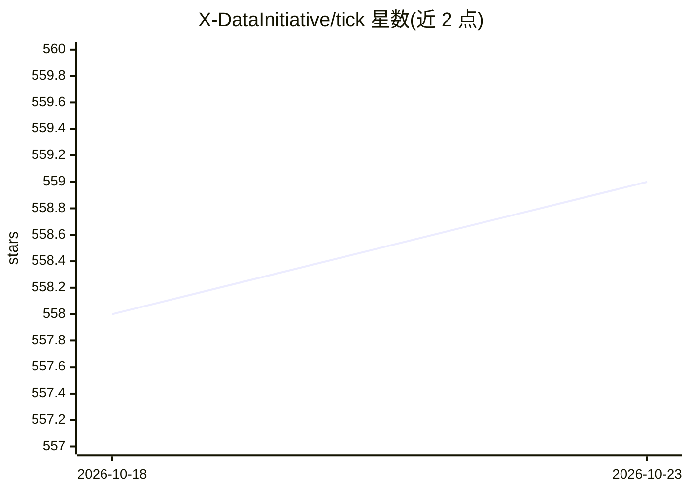

# X-DataInitiative/tick

⭐ 559 · Python · BSD-3-Clause · 推送 2026-06-15 · [GitHub](https://github.com/X-DataInitiative/tick) · [官网](https://x-datainitiative.github.io/tick/) · 组织维护

**面向时序/点过程的 Python 3 统计学习库**

Python 3 机器学习库，聚焦时变系统（如点过程）的统计学习，同时提供广义线性模型工具与通用优化工具箱：核心为含模型计算类、求解器和近端算子的优化模块，支持线性/逻辑/泊松回归，可模拟 Hawkes 过程并按多种核假设做推断。2016 年由巴黎综合理工学院数据科学团队创建，使用 Intel MKL，已在医疗健康数据库分析、金融订单簿建模、社交媒介信息传播等场景应用。通过 pip 安装，需编译 C++ 扩展；Windows 为实验性支持。

## 筛选速览

| 维度 | 判定 | 备注 |
|---|---|---|
| AI 角色 | `ai-native` | 本体是模型或模型工具 |
| 许可风险 | `permissive` | BSD-3-Clause |
| 部署形态 | `library` | 以包/库形式分发 |
| 模型依赖 | — | README 未给出锁定关系 |
| 硬件要求 | — | 无带数字的原话,不猜 |
| 安装摩擦 | `low` | 无编译、无系统依赖或容器化 |
| 成熟度 | `idea` | |

## 能力要点

- 模型/求解器/近端算子的通用优化工具箱
- 线性、逻辑、泊松回归
- Hawkes 过程模拟与多核假设下的推断
- 使用 Intel MKL，从桌面机到高性能服务器均运行

## 适用场景

- 对金融高频订单簿做点过程建模
- 医疗数据库中的药物警戒弱信号检测
- 社交媒体信息传播网络推断
- 做带正则化的广义线性模型回归分析

## 场景标签

`金融量化` · 领域:学习与行业

## 证据(README 行号)

> L18: _tick_ is a machine learning library for Python 3. The focus is on statistical learning for time dependent systems,
> L22: - Simulate point Hawkes processes with standard or exotic kernels.

## 星数曲线

2026-10-18 558 → 2026-10-23 559（+1）

---
*卡片 v1 · prompt 1.4 · 生成 2026-10-21 · 置信度 high · 依据 README sha `eac8af7c1bea` · [字段定义](../../DATASET.md)*
