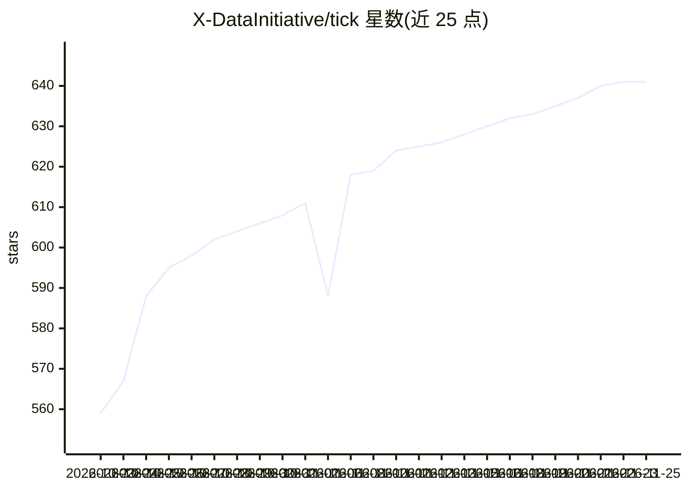

# X-DataInitiative/tick

⭐ 641 · Python · BSD-3-Clause · 推送 2026-11-10 · [GitHub](https://github.com/X-DataInitiative/tick) · [官网](https://x-datainitiative.github.io/tick/) · 组织维护

**面向时间依赖建模的 Python 统计学习库**

tick 是 Python 3 的机器学习库，聚焦时间依赖系统的统计学习，如点过程。核心是优化模块，提供模型计算类、求解器与近端算子用于正则化；并包含广义线性模型工具与通用优化工具箱，支持线性/逻辑/Poisson 回归、Hawkes 过程的模拟与推断。需要 Python 3.11+ 及 numpy/scipy，Linux/macOS/Windows 提供 PyPI 预编译 wheel，支持源码安装。由 École Polytechnique 数据科学倡议团队维护，有 JMLR 论文。

## 筛选速览

| 维度 | 判定 | 备注 |
|---|---|---|
| AI 角色 | `ai-native` | 本体是模型或模型工具 |
| 许可风险 | `permissive` | BSD-3-Clause |
| 部署形态 | `library` | 以包/库形式分发 |
| 模型依赖 | — | README 未给出锁定关系 |
| 硬件要求 | — | 无带数字的原话,不猜 |
| 安装摩擦 | `low` | 无编译、无系统依赖或容器化 |
| 成熟度 | — | 结构信号不足 |

## 能力要点

- 点过程（Hawkes 过程）的模拟与多种核假设下的推断
- 优化模块：模型计算类、求解器、近端算子正则化
- 广义线性模型工具与通用优化工具箱
- Linux/macOS/Windows 预编译 wheel 发布于 PyPI

## 适用场景

- 药物警戒中检测微弱信号
- 金融高频订单簿建模
- 社交媒体信息传播网络分析

## 场景标签

`金融量化` · 领域:学习与行业

## 证据(README 行号)

> L12: _tick_ is a Python 3 module for statistical learning, with a particular emphasis on time-dependent modeling. It is 
> L18: _tick_ is a machine learning library for Python 3. The focus is on statistical learning for time dependent systems,

## 星数曲线

2026-10-23 559 → 2026-11-25 641（+82）

---
*卡片 v1 · prompt 1.4 · 生成 2026-11-24 · 置信度 high · 依据 README sha `6f3f49f954ed` · [字段定义](../../DATASET.md)*
