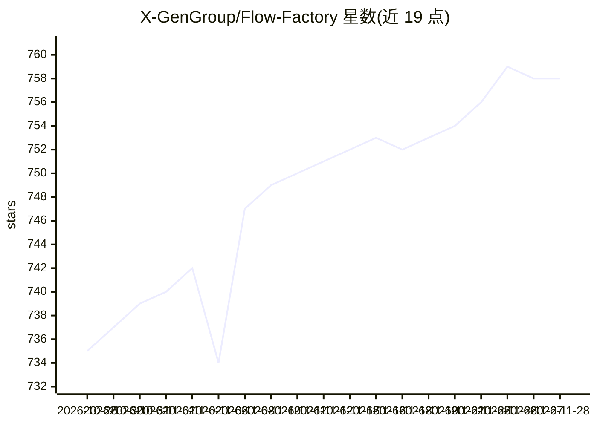

# X-GenGroup/Flow-Factory

⭐ 758 · Python · Apache-2.0 · 推送 2026-11-27 · [GitHub](https://github.com/X-GenGroup/Flow-Factory) · 组织维护 · 中文 README

**扩散/流匹配模型的统一微调与在线 RL 训练框架**

以统一配置接口对图像、编辑、视频与音视频联合模型做离线微调与在线奖励优化的训练框架：先选模型与目标，再选兼容算法与 GPU 布局。注册 19 个训练器（SFT、DPO、GRPO、ReFL、DRaFT-K、蒸馏类等），支持全量权重或 LoRA，训练后端覆盖 DDP、DeepSpeed ZeRO-2 与 FSDP2，模型适配器声明 TP/SP/CP 并行路径。依赖 Python 3.11+ 与 PyTorch 2.11+，经 git clone 源码安装，提供 CUDA 训练镜像与多节点启动说明。面向需要微调生成模型的开发者。

## 筛选速览

| 维度 | 判定 | 备注 |
|---|---|---|
| AI 角色 | `ai-ecosystem` | LLM/agent 周边工具 |
| 许可风险 | `permissive` | Apache-2.0 |
| 部署形态 | `library` | 以包/库形式分发 |
| 模型依赖 | — | README 未给出锁定关系 |
| 硬件要求 | — | 无带数字的原话,不猜 |
| 安装摩擦 | `medium` | 含编译或系统依赖之一 |
| 成熟度 | — | 结构信号不足 |

## 能力要点

- 19 个注册训练器覆盖 SFT、DPO、GRPO、ReFL、DRaFT-K 与蒸馏算法
- 支持 SD3.5、FLUX、Qwen Image、Wan、LTX-2、MiniMax H3 等模型家族的适配器
- FSDP2 组合 TP/SP/CP 的并行布局（4/8 GPU 快速上手）
- ff-prompt-enhance 用模型自带提示增强器改写数据集提示

## 适用场景

- 对文生图或图生图模型做 LoRA/SFT 离线微调
- 用 GRPO 等在线 RL 按奖励模型优化扩散模型
- 在多 GPU 环境下用 FSDP2+TP/CP 布局训练大参数视频模型

## 场景标签

`微调` `强化学习` · 领域:训练与推理

## 证据(README 行号)

> L5:  Unified Online RL and Offline Fine-Tuning for Diffusion and Flow-Matching Models
> L16: |Algorithm|19 registered trainers, including SFT, DPO, GRPO/Guard, DiffusionART, iTDM, ReFL, DRaFT-K and DRTune|Alg
> L189: git clone https://github.com/X-GenGroup/Flow-Factory.git

## 星数曲线

2026-10-26 735 → 2026-11-28 758（+23）

---
*卡片 v1 · prompt 1.4 · 生成 2026-11-28 · 置信度 high · 依据 README sha `33ca4fac7aed` · [字段定义](../../DATASET.md)*
