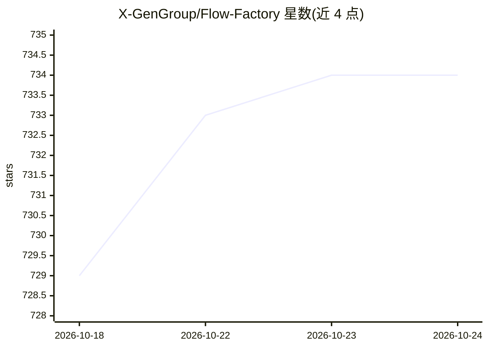

# X-GenGroup/Flow-Factory

⭐ 734 · Python · Apache-2.0 · 推送 2026-10-21 · [GitHub](https://github.com/X-GenGroup/Flow-Factory) · 组织维护 · 中文 README

**扩散与 Flow-Matching 模型的统一微调框架：SFT/DPO/在线 RL**

面向扩散与 Flow-Matching 生成模型的训练框架，覆盖文生图、图生图、文生视频及音视频生成等任务的多种模型（FLUX 系列、Qwen-Image、SD3.5、Wan2.x、LTX-2、MiniMax H3 等）。提供 SFT、离线/在线 DPO、GRPO 等 14 种算法，模型与算法在接口层解耦，附 ready-to-run 配方。统一 V2 JSONL 数据格式，支持 LoRA 配方、prompt 增强步骤、注意力后端加速、DeepSpeed 与多节点训练。需 Python 3.10+/PyTorch 2.10+，视频任务需 FFmpeg 共享库；FLUX.3 与 Qwen-Image 2.1 需安装 pinned Diffusers 子模块。

## 筛选速览

| 维度 | 判定 | 备注 |
|---|---|---|
| AI 角色 | `ai-ecosystem` | LLM/agent 周边工具 |
| 许可风险 | `permissive` | Apache-2.0 |
| 部署形态 | `library` | 以包/库形式分发 |
| 模型依赖 | — | README 未给出锁定关系 |
| 硬件要求 | — | 无带数字的原话,不猜 |
| 安装摩擦 | `medium` | 含编译或系统依赖之一 |
| 成熟度 | — | 结构信号不足 |

## 能力要点

- 14 种训练算法（SFT/DPO/GRPO/DMD2 等），模型与算法解耦
- 支持 30+ 个扩散/Flow-Matching 模型（图像、视频、音视频）
- ff-prompt-enhance 独立步骤：训练前用模型自带 rewriter 重写数据集 prompt
- 统一 V2 JSONL 数据格式与 CUDA Docker 训练镜像、多节点启动

## 适用场景

- 对 FLUX/Qwen-Image 等生成模型做 GRPO + LoRA 强化学习微调
- 用自有演示或偏好数据做 SFT / 离线 DPO 训练
- 训练前批量重写数据集 prompt 以提升数据质量
- 多节点 GPU 集群上训练大尺寸视频生成模型

## 场景标签

`微调` `强化学习` · 领域:训练与推理

## 证据(README 行号)

> L5:  Unified Online RL and Offline Fine-Tuning for Diffusion and Flow-Matching Models
> L122: Models and algorithms are decoupled at the framework interface. Ready-to-run recipes are indexed in

## 星数曲线

2026-10-18 729 → 2026-10-24 734（+5）

---
*卡片 v1 · prompt 1.4 · 生成 2026-10-21 · 置信度 mid · 依据 README sha `033da2047959` · [字段定义](../../DATASET.md)*
