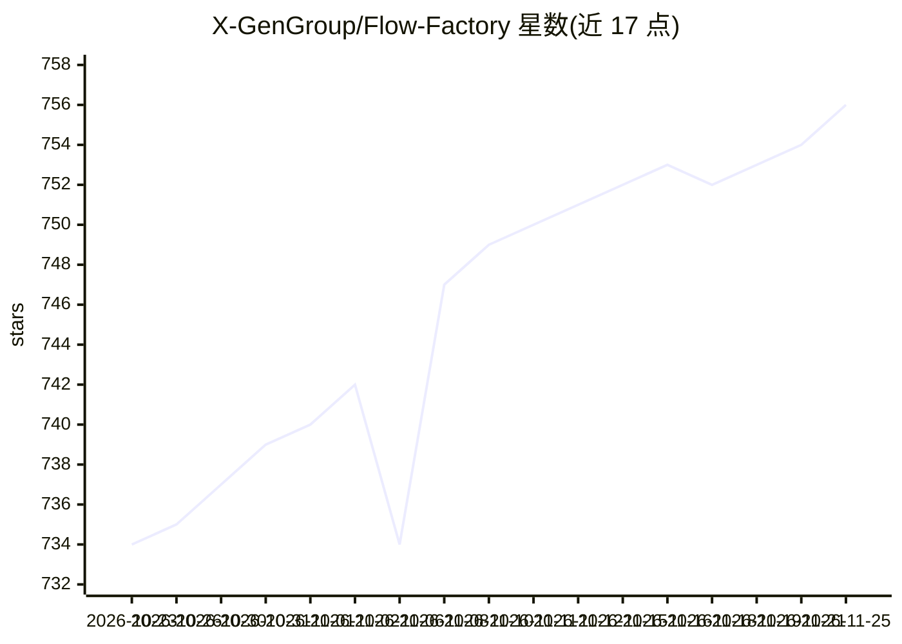

# X-GenGroup/Flow-Factory

⭐ 756 · Python · Apache-2.0 · 推送 2026-11-23 · [GitHub](https://github.com/X-GenGroup/Flow-Factory) · 组织维护

**给研究/训练者的扩散与流匹配模型统一微调框架**

以统一配置接口组织扩散/流匹配模型的离线微调与在线强化学习训练：先选模型与目标，再选兼容的算法与 GPU 布局。注册 19 个模型适配器（SD3.5、FLUX、Qwen Image、Wan、LTX-2、Bagel 等）与 18 种训练器（SFT、DPO、GRPO、ReFL、DRaFT-K 等），支持全权重或 LoRA、DDP/DeepSpeed/FSDP2 后端及 TP/SP/CP 并行组合。通过 git clone 源码安装，要求 Python 3.11+ 与 PyTorch 2.11+，模型覆盖边界在文档中单独说明，EP/DeepEP 属于规划功能。

## 筛选速览

| 维度 | 判定 | 备注 |
|---|---|---|
| AI 角色 | `ai-ecosystem` | LLM/agent 周边工具 |
| 许可风险 | `permissive` | Apache-2.0 |
| 部署形态 | `library` | 以包/库形式分发 |
| 模型依赖 | — | README 未给出锁定关系 |
| 硬件要求 | — | 无带数字的原话,不猜 |
| 安装摩擦 | `medium` | 含编译或系统依赖之一 |
| 成熟度 | `idea` | |

## 能力要点

- 18 个注册训练器与 19 个模型适配器，覆盖图像、编辑、视频与音视频联合模态
- 训练后端支持 DDP、DeepSpeed ZeRO-2 与 FSDP2，含 TP/SP/CP 并行布局
- ff-prompt-enhance 独立步骤：训练前用模型提示增强器重写数据集提示词
- 内置 wandb/swanlab/tensorboard 实验跟踪，在线可视化训练样本与指标曲线

## 适用场景

- 用 GRPO + LoRA 配方微调 FLUX/Qwen-Image 等文生图模型
- 对 Wan/LTX-2 视频与音视频模型做奖励驱动的在线 RL 训练
- 在 4/8 卡 GPU 上按 FSDP2×TP×CP 布局做并行训练
- 用 SFT 与离线 DPO 在自备演示/偏好数据上做离线微调

## 场景标签

`微调` `强化学习` · 领域:训练与推理

## 证据(README 行号)

> L5:  Unified Online RL and Offline Fine-Tuning for Diffusion and Flow-Matching Models
> L16: |Algorithm|18 registered trainers, including SFT, DPO, GRPO/Guard, DiffusionART, ReFL, DRaFT-K and DRTune|Algorithm
> L160: Models and algorithms are decoupled at the framework interface. Ready-to-run recipes are indexed in

## 星数曲线

2026-10-23 734 → 2026-11-25 756（+22）

---
*卡片 v1 · prompt 1.4 · 生成 2026-11-25 · 置信度 mid · 依据 README sha `3deb655fca6a` · [字段定义](../../DATASET.md)*
